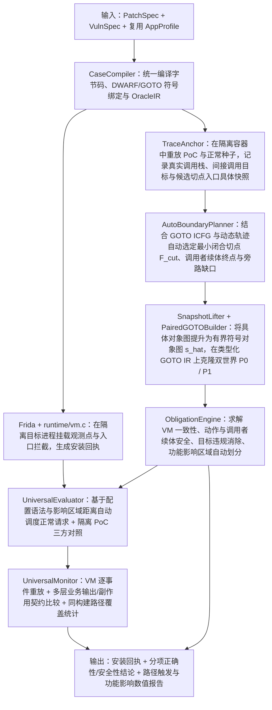

# VulGate 通用自动部署与验证系统方案（PoC/种子轨迹锚定 + 类型化 GOTO 差分配对 + 通用功能影响测量）

日期：2026-11-13。本文定义下一阶段完整实现方案，目标是将现有 20 例实验与 `tools/postdeploy`、`tools/verification` 两条支线收敛为一套零逐漏洞手写验证代码的自动化系统。

## 1. 系统目标与端到端闭环

对已接入的目标软件（Nginx、Apache httpd、PHP、Brotli 等），每次验证任意新补丁时只输入两份声明数据：

1. **补丁包（`PatchSpec`）**：观测点、函数入口拦截点、eBPF VM 策略（DSL 或 `.bin` 字节码）、显式映射声明、引用的可信目录动作 `action_id` 及部署时点前提。
2. **结构化漏洞信息（`VulnSpec`）**：人工从漏洞报告、官方修复或隔离靶场复现整理的缺陷位置锚点、参数化安全性质模板、运行配置夹具、可选的隔离容器 PoC 复现器与正常功能种子。

系统自动完成以下完整闭环，中间**不编写任何逐 CVE 的 `symbolic_adapter.c`、`corpus.py`、`snapshot_inputs()` 或按 CVE 分支的 `suite.py` 逻辑**：



---

## 2. 现有实现缺口定位：为什么其余 19 例尚未完成真实状态差分分析与调用者续体证明

对照当前仓库实现，阻碍其余 19 例接入真实状态差分符号执行与通用返回安全证明的代码瓶颈集中在五处：

| 现有模块 | 当前具体限制 | 统一方案中的替代机制 |
|---|---|---|
| `tools/postdeploy/product.py` | 限制 `len(manifest['guards']) == 1`、`return_type == 'int'`、`action['kind'] == 'return_int'`、最多 1 张观测表；依赖逐例手写 `symbolic_adapter.c`（如 Brotli 手写 `pd_application` 拼装 `BrotliDecoderState`）直接调用被挂钩函数，不包含真实调用者续体 | **类型化 GOTO IR 双世界克隆器（`PairedGOTOBuilder`）**：直接在 `goto-cc` + `typed_transport.py` 导出的类型化 GOTO IR 上克隆 `P0`/`P1`，原生支持多 guard、多 observer、`int`/`int64`/`void`/`pointer`/`return_string` 及带字段赋值的目录动作（如 `e->ip`、`e->status`），并保留到切点退出处的完整调用者续体 |
| `tools/postdeploy/plan.py` | 仅调用 `goto-instrument --call-graph` 检查人工指定的 `symbolic_root` 能否到达 `hook_function`，`automatic_world_cloning=False`，不计算调用者清理闭包或旁路切集 | **轨迹与图联合规划器（`AutoBoundaryPlanner`）**：在带间接调用解析的 GOTO ICFG 上求观测点、拦截点、缺陷锚点与返回动作影响闭包的最小支配切点 `F_cut`，自动枚举多调用者并输出未覆盖旁路 |
| 状态构造缺失 | Nginx/httpd/PHP 入口依赖复杂的配置树（`loc_conf`、`ctx_index`、filter 链、Zend 全局表）和函数指针，从 `main` 符号执行路径爆炸，纯欠约束构造又产生大量不可达伪崩溃 | **PoC/种子重放快照提升器（`SnapshotLifter`）**：借鉴 SymRadar 与 VulnFix，在隔离容器中重放 PoC/正常种子提取 `F_cut` 入口真实内存对象图 `s`，固定配置骨架与函数指针，将请求数据面提升为保持别名与指针序关系的有界符号对象图 `s_hat` |
| `tools/postdeploy/runner.py` 与 `experiments/postdeploy/benchmark20/suite.py` | `runner.py` 依赖逐漏洞 Python 模块提供 `cases()` 与 `snapshot_inputs()`；`suite.py` 按 17 个 `kind` 分支手写配置与请求 | **通用评估与监控引擎（`UniversalEvaluator` + `UniversalMonitor`）**：从统一字段绑定表自动生成快照到符号变量的逆映射；解析运行配置夹具与协议 schema 自动生成固定评价集与区域引导变异流；统一比较协议输出、文件/会话副作用与路径边覆盖 |
| `tools/postdeploy/contract.py` 与 `runtime/vm.c` | `contract.py` 仅证明标量局部蕴含 `must_block => BLOCK`；`runtime/vm.c` 校验器禁止向后跳转，尚未接入有界循环指令与编译链 | **四类统一证明义务（`ObligationEngine`）+ 有界循环 VM 扩展**：连接 `tools/verification/shadow.py` 的未初始化内存阴影检查与对象生命周期阴影，统一证明字节码等价、调用者续体安全、目标违规消除与影响区域划分；扩展 VM 支持显式计数器有界循环 |

---

## 3. 详细输入规格设计：通过结构化输入支撑全自动选点、快照提取与判定生成

系统将输入拆分为**每个应用一次性注册的 `AppProfile`** 与**每次补丁验证提交的 `PatchSpec` + `VulnSpec`**。不在验证代码中硬编码任何漏洞逻辑；所有有助于定界、选点和判定的信息均声明在数据结构中。

### 3.1 补丁包规格（`PatchSpec`）

补丁保持已确定的安全架构：拦截逻辑只读宿主状态与私有显式映射，仅输出两态决策（自然结束为 `PASS`，显式触发 `BLOCK`），具体返回码与必要的错误协议状态写入全部来自可信动作目录 `ActionCatalog`。

```yaml
schema: vulgate.patch/v2
target_build: app://nginx/1.31.6-captured
install_precondition:
  quiescent_phase: worker_post_init_pre_request
maps:
  script_frames:
    key_type: {tuple: [u64, pointer]}
    value_type: {struct: [{reserved: u64}, {alloc_len: u64}, {base: pointer}, {end: pointer}]}
    capacity: 256
    scope: thread
    on_full: block
observers:
  - id: obs_script_region
    site: {file: src/http/ngx_http_script.c, function: ngx_http_script_run, anchor: after_assign_e_end}
    operation: set
    map: script_frames
    key_expr: "[__vg_tid, e]"
    value_expr: "{reserved: len, alloc_len: value->len, base: value->data, end: e->end}"
  - id: obs_script_cleanup
    site: {file: src/http/ngx_http_script.c, function: ngx_http_script_run, anchor: function_exit}
    operation: delete
    map: script_frames
    key_expr: "[__vg_tid, e]"
guards:
  - id: guard_http_script_len
    site: {file: src/http/ngx_http_script.c, function: ngx_http_script_check_length, phase: entry}
    selectors:
      engine: {c_expr: "e"}
      copy_len: {c_expr: "len"}
      pos_ptr: {c_expr: "e->pos"}
      end_ptr: {c_expr: "e->end"}
    map_reads:
      - map: script_frames
        key_expr: "[__vg_tid, e]"
        into_slot: frame
        consume: false
        on_missing: pass
    policy_dsl: |
      if (frame.present && frame.reserved > 0) {
          u64 used = pos_ptr - frame.base;
          u64 phys_rem = frame.alloc_len - used;
          u64 logic_rem = frame.alloc_len - frame.reserved - used;
          if (copy_len <= phys_rem && copy_len > logic_rem) {
              BLOCK();
          }
      }
    action_id: NGX_HTTP_SCRIPT_EXIT_ERROR
```

目录动作由确定性候选分析器预先从源码现有错误返回路径提取并签名，例如 `NGX_HTTP_SCRIPT_EXIT_ERROR` 包含固定写入 `e->ip = &ngx_http_script_exit_code; e->status = 500;` 与 `return -1`。

### 3.2 结构化漏洞信息规格（`VulnSpec`）

为了让系统在**不手写验证器**的前提下自动确定符号执行切点、自动提取真实程序状态并自动生成违规判定，`VulnSpec` 定义五个结构化部分：

1. **`environment_fixture`**：触发该模块所需的真实服务配置（如启用 `alias`、`dav_methods`、`mod_xml2enc`、`session.upload_progress` 的配置文件片段及静态资源夹具）。该夹具同时供隔离容器重放、Frida 动态部署测试以及通用协议变异器提取路由/参数词表。
2. **`defect_anchors`**：
   - `sink_site`：最终发生非法效果的源码位置与指令角色（内存写、内存读、释放、算术或敏感状态修改）。
   - `root_cause_site`（可选）：错误状态首次产生的位置（如 Brotli `DecodeBlockTypeAndLength`、Nginx `ncaptures` 残留处），用于强制切点规划器将根因到汇点的传播链纳入同一验证范围。
   - `state_carrier`（可选）：跨函数、跨异步回调或跨请求携带受损状态的宿主表达式及其生命周期（`call_tree | request | connection | worker`）。
3. **`safety_oracle`**：独立于待测补丁的安全判定规格，从系统内置的六类可编译模板中选取并绑定宿主表达式：
   - `physical_memory_safety`：利用 CBMC 对象边界与指针检查自动判定物理越界读写与空/野指针解引用。
   - `logical_region_bounds`：在物理分配块内部检查子对象/预留区边界，绑定 `{ptr_expr, width_expr, base_expr, logical_len_expr}`（直接覆盖 Nginx `CVE-2026-93479` 脚本预留空间侵占）。
   - `temporal_object_validity`：对象存活代次与引用计数一致性，绑定 `{object_expr, refcount_expr, active_events}`（覆盖 UAF、双重释放与 Nginx AIO/httpd rewrite lookahead 生命周期问题）。
   - `initialized_read_safety`：接入 `tools/verification/shadow.py` 的别名感知字节级定义性阴影，自动检测任何分支、解引用、返回或释放对未初始化内存的读取。
   - `arithmetic_domain_safety`：有符号/无符号溢出、除零及流向长度参数的截断回绕检查。
   - `state_invariant`：在指定程序点或生命周期边界检查声明式 C 布尔关系（覆盖重入禁止、跨请求全局变量复位、捕获槽位一致性等语义漏洞）。
4. **`seed_traces`（重放定界与状态锚定种子）**：
   - `poc_reproducer`（可选但推荐，严格在隔离容器中运行）：能够到达缺陷路径或触发 `safety_oracle` 的协议请求/操作序列，以及多次调用时的目标调用选择器 `invocation_selector`（默认 `last_before_fault`，与 SymRadar 一致；多步状态漏洞可选 `all_in_episode`）。
   - `benign_seeds`：激活当前配置模块的一组正常功能种子请求（补充应用级基础回归集）。
5. **`symbolization_scope`（可选微调，具备全自动默认规则）**：
   - 默认策略将请求启动前已固定的配置结构与函数指针保持为快照具体值，将请求期输入缓冲区、长度、标志位与解析器状态设为有界符号变量；必要时可通过 `pin_concrete` 或 `force_symbolic` 显式覆盖，并在报告中记录该范围约束。

```yaml
schema: vulgate.vuln/v2
case_id: CVE-2026-93479
application: app://nginx/1.31.6-captured
environment_fixture:
  config_template: fixtures/nginx_script_reserved.conf
  files:
    www/index.html: "ok"
defect_anchors:
  sink_site:
    file: src/http/ngx_http_script.c
    function: ngx_http_script_copy_code
    line: 718
    role: memory_write
  root_cause_site:
    file: src/http/ngx_http_script.c
    function: ngx_http_script_run
    line: 658
  state_carrier:
    expr: "*e"
    lifetime: call_tree
safety_oracle:
  kind: logical_region_bounds
  at: sink_site
  bindings:
    ptr_expr: "e->pos"
    width_expr: "code->len"
    base_expr: "value->data"
    logical_len_expr: "value->len - reserved_len"
seed_traces:
  poc_reproducer:
    protocol: http1
    requests:
      - method: GET
        uri: "/dynamic/file.txt?dir=excessive_reserved_trigger"
    invocation_selector: last_before_fault
  benign_seeds:
    - method: GET
      uri: "/plain"
    - method: GET
      uri: "/dynamic/file.txt?dir=dynamic"
budgets:
  loop_unwind: 32
  max_symbolic_bytes: 256
  max_impact_regions: 12
  solver_timeout_sec: 180
```

### 3.3 一次性应用包规格（`AppProfile`）

同一软件仅注册一次，跨该软件全部 CVE 复用：

- **`build_artifacts`**：`tools/build_capture.py` 捕获的 `compile_commands.json`、带 DWARF 符号与覆盖探针的真实二进制，以及 `goto-cc` 生成的全模块类型化 GOTO IR 库。
- **`lifecycle_hooks`**：进程静止挂载点 `quiescent_attach`、单次操作起点 `operation_begin` 与终点 `operation_end`、跨请求重置方式（进程重启或确定性请求清理后快照校验）。
- **`allocator_and_lib_models`**：标准 C 分配器及应用专有池分配器（`ngx_palloc`/`ngx_pcalloc`、`apr_palloc`/`apr_brigade`、`emalloc`/`efree`/`zend_bailout`）的 GOTO IR 模型，精确记录每次分配的动态对象大小与未初始化阴影位。
- **`protocol_driver` 与 `observable_contract`**：通用协议收发与变异驱动（HTTP/1.1、HTTP/2、gRPC、CLI 流、C API RPC），以及多层可观察结果提取器（响应码/头/正文、目标目录文件树哈希、会话存储快照、后端代理收到请求记录、进程存活与资源计数）。

---

## 4. 吸收前序论文方法的通用自动验证算法设计

针对用户提出的“利用重放 PoC 做符号执行确定范围，避免每个漏洞手写验证方式”，我们将此前核对过的 **SymRadar（ICSE'26）、CPR（PLDI'21）、VulnFix（ISSTA'22）、KLAUS（USENIX Sec'23）、VeriBin（NDSS'25）、PVBench（2026）** 中各自成立的核心机制融合进统一引擎，并修正它们直接用于动态入口拦截补丁时的缺陷：

| 借鉴来源 | 采纳的具体机制 | 在本系统中的改造与边界修正 |
|---|---|---|
| **SymRadar** | 重放 PoC 提取目标入口最后一次相关调用的具体快照 `s`；保留指针别名拓扑、具体函数指针与具体 `fd`，将叶缓冲区和基本类型替换为有界符号变量得到抽象快照 `s_hat`；保持同缓冲区 `start <= end` 序关系 | **修正两处致命局限**：① 不在被挂钩函数自身截断，而是自动上移到包住调用者清理续体的外层切点 `F_cut` 提取快照，从而能捕获 `*out=NULL` 遗漏等返回后错误；② 废除 SymRadar Table 1 忽略“非原崩溃类型的新崩溃”启发式，凡 `P0` 定义良好而 `P1` 触发未初始化读取/越界/死锁均严格判为 `VIOLATED` |
| **CPR** | 利用初始触发输入建立具体路径前缀，沿途收集输入约束并翻转分支谓词生成邻近分区的新输入 | 用于**影响区域向外部协议输入的投影与距离引导变异**：从 Frida 实时回传的守卫操作数计算分支距离，引导协议变异器翻转守卫与调用者条件 |
| **VulnFix** | 将“从外部入口到达深层位置的困难可达性问题”交由真实执行解决，将“局部状态空间完备探索”交由快照上的 SMT/符号执行解决，并用通用 Sanitizer + 对象元数据充当错误标签 | 隔离容器动态执行启用 ASan/UBSan + 自定义 `safety_oracle` 探针做运行时裁决；GOTO 符号端统一启用指针/边界/溢出/未初始化阴影断言，无需逐漏洞手写断言函数 |
| **KLAUS** | 静态提取补丁前后的读写足迹引导探索范围；发现异常时通过“去补丁原版同输入重放”精确归因是否为补丁引入的新问题 | 从 `PatchSpec` 自动提取 `{ObserverReads, MapOps, GuardReads, ActionWrites, SkippedCalleeWrites}` 作为足迹闭包，决定切片范围与三方重放归因 |
| **VeriBin + PVBench** | 路径蕴含配对减少 SMT 公式规模，未触及足迹的纯外部辅助调用采用耦合未解释函数摘要；多层输出与中间副作用比较 | 纯辅助函数在 `P0`/`P1` 实参相等时共享同一符号返回值；功能契约同时覆盖协议响应、文件/数据库/会话副作用与内部完成事件 |

---

## 5. 核心模块与完整算法流程

### 5.1 算法一：结合动态轨迹与静态 ICFG 的自动选点与续体定界（`AutoBoundaryPlanner`）

给定编译后的类型化 GOTO IR 与隔离容器对 `seed_traces`（`poc_reproducer` + `benign_seeds`）的轻量追踪结果：

1. **构建增强过程间控制流图 `ICFG+`**：
   - 从 GOTO IR 提取全部直接调用边、读写集合与地址被取用的函数集合。
   - 将动态重放实际观测到的函数指针调用目标（如 Nginx phase handler、output filter、script code 函数，httpd filter/hook，PHP SAPI handler）并入间接调用点；对未观测但类型兼容的静态目标保留为保守边，对完全外部的动态库符号标记为 `unresolved_external_edge`。
2. **计算必包事件集 `M` 与动作影响闭包 `Cont(g, a)`**：
   - 令 `M = Observers(PatchSpec) ∪ Guards(PatchSpec) ∪ DefectAnchors(VulnSpec)`。
   - 对每个入口守卫 `g` 及其绑定动作 `a`，在每个可达调用点 `call_site(caller -> g)` 处做前向数据流与控制流切片：
     - 追踪返回值变量、`g` 原函数体可能写入但 `a` 未写入的所有指针实参（捕获未初始化输出参数风险）、`a.writes` 显式修改的结构体字段（如 `e->ip`、`e->status`），以及调用点处已持有的局部锁、引用计数和待释放对象；
     - 沿调用栈向上扩展，直到返回值已被上层消费转化为确定状态且所有局部输出对象/资源均已完成销毁或协议化移交，记该终点集为 `Exit(g, a)`。
3. **自动选定最小闭合切点 `F_cut`**：
   - 在从 `AppProfile.operation_begin` 到 `M` 的调用链上，自动选取深度最深（最贴近业务局部以最小化符号规模）且同时满足以下四条闭合条件的函数集 `{F_cut}`：
     1. 关联的 `Observers`、`Guards` 与 `DefectAnchors` 均位于 `F_cut` 的动态调用子树内（若 `Observer` 位于安装期或前序请求，则作为 `F_cut` 入口的显式初始映射状态传入）；
     2. 所有 `Cont(g, a)` 的生命周期在 `F_cut` 返回前闭合（例如 `parse_record` 自动上移至 `handle_request`；Nginx `script_check_length` 自动上移至 `ngx_http_script_run`；Brotli `WriteRingBuffer` 自动上移至 `ProcessCommands` / `BrotliDecoderDecompressStream`）；
     3. 若被挂钩函数存在多个不同调用者（如 `ngx_http_map_uri_to_path` 的 18 个调用点），按调用者分别生成独立的 `VerificationTask`（优先验证当前配置与种子激活的调用者，并对其余静态可达调用者逐一生成局部续体任务）；
     4. 若 `state_carrier.lifetime` 为 `connection` 或 `worker`（如 PHP 跨请求全局状态、httpd HTTP/2 会话重入、Nginx AIO 挂起计数），自动将单次 `F_cut` 包装为有界序列驱动 `EpisodeDriver(K)`（默认 `K=2`：第一次操作允许触发 `BLOCK` 或异常路径，紧接执行清理钩子与第二次操作，验证跨事件状态不变式）。
4. **全路径覆盖与旁路静态检查（`CutCompletenessCheck`）**：
   - 在 `ICFG+` 上计算从所有激活的 `operation_begin` 到 `defect_anchors.sink_site` 的路径是否全部穿过已安装 `Guards`：
   - 若存在不经过任何已安装 `Guard` 的可达路径（如 `CVE-2026-56153` 的输入侧 `xlate_in_filter -> finish_partial_char`、`CVE-2026-93479` 的 `stream` 模块脚本、`CVE-2026-97205` 的直接 upstream/cache AIO 路径），自动提取最短旁路调用链写入报告的 `bypass_paths` 字段，并将 `operation_coverage` 判定上限锁定为 `PARTIAL`（绝不误报为全漏洞消除）。

### 5.2 算法二：真实应用状态的自动提取与抽象对象图提升（`SnapshotLifter`）

无需手写任何 C 结构体初始化代码，按以下四步把真实进程在 `F_cut` 入口的内存状态自动编译为 GOTO 初始状态构造器：

1. **隔离容器具体快照采集**：
   - 在隔离容器内启动带 DWARF 符号与分配器大小记录表的基线程序 `P0`，加载 `environment_fixture`。
   - 发送 `poc_reproducer`（若有）及代表性 `benign_seeds`。当执行到达选定的 `F_cut` 入口（对 PoC 取触发目标错误前的最后一次调用）时，由调试/原生探针从根集 `Roots = FormalParams(F_cut) ∪ ReadStaticGlobals(Subtree(F_cut))` 出发按 DWARF/GOTO 类型做有界宽度优先扫描。
   - 记录逻辑对象表 `Objects = {O_1, ..., O_m}`（含精确分配字节数、静态类型、原始字节内容）与逻辑指针边 `(O_i, offset) -> (O_j, target_offset)` 或 `-> ELF_Symbol(fn_name)`。所有裸虚拟地址在此步全部消去，转为逻辑对象 ID 与对象内偏移。
2. **三层自动符号化规则（`s -> s_hat`）**：
   - **第一层（具体固定层 — 消除不可达状态与间接调用爆炸）**：所有函数指针字段保持快照解析出的真实函数符号；在 `operation_begin` 之前完成初始化且在 `Subtree(F_cut)` 内只读的配置结构体骨架（如 `ngx_module_t`、`ctx_index`、`apr_Harmony` 表、只读配置常量、已打开文件描述符）保持快照具体值。
   - **第二层（结构约束层 — 保持指针拓扑与缓冲区序关系）**：同一对象图中的指针别名关系严格保持（`s` 中指向同一逻辑对象 `O_k` 的两个指针在 `s_hat` 中仍指向同一 `O_k` 的对应符号偏移）；指向同一缓冲区的指针组（如 `(start, pos, last, end)`）自动生成非负偏移与单调序约束 `0 <= off_start <= off_pos <= off_last <= off_end <= size(O_k)`；可空输入指针按类型与前缀非空性保留 `NULL` 分支或有效对象分支。
   - **第三层（数据面全符号化层 — 覆盖快照邻域输入空间）**：请求期标量字段（长度、计数、状态位域、协议枚举、输入块大小）替换为同位宽无约束符号变量 `nondet_*()`；叶字节数组（URI、头部值、消息体、压缩块缓冲区）替换为有界长度 `B` 的符号字节数组。`F_cut` 函数体内部声明的局部变量不包含在入口快照中，在 GOTO 执行到 `DECL` 时自然创建，其 `vulgate_uninitialized` 阴影位初始为 `1`（未初始化）。
3. **前序静态前缀直连模式（可选升级证明范围）**：
   - 当 `F_cut` 本身就是外部自包含入口（如库函数接口或轻量解析入口）时，系统同时支持不依赖快照、直接从 `operation_begin` 构造符号输入的 `OPERATION_PREFIX_BOUNDED` 模式，报告自动区分 `scope.kind = "snapshot_neighborhood"` 与 `scope.kind = "operation_bounded"`。

### 5.3 算法三：类型化 GOTO IR 双世界克隆与多挂点插桩（`PairedGOTOBuilder`）

完全替代 `tools/postdeploy/product.py` 的单函数 C 字符串拼接：

1. **双命名空间克隆**：
   - 从项目 GOTO 库抽取 `Subtree(F_cut)` 切片，复制全部相关函数与可写静态全局变量为 `__vg_w0_<sym>`（原程序 `P0`）与 `__vg_w1_<sym>`（安装补丁程序 `P1`）。
   - 生成顶层验证入口 `__vg_paired_harness()`：先构造一份共享的符号参数向量 `SymVec`，再分别调用 `__vg_instantiate_state_w0(SymVec)` 与 `__vg_instantiate_state_w1(SymVec)` 生成两套完全同构但地址互不混叠的对象图副本。
2. **完整策略语义织入 `__vg_w1_*`**：
   - 在每个 `Observer` 对应的 GOTO 指令位置织入对 `__vg_w1_maps[map_id]` 的类型化键值写入或删除。
   - 在每个 `Guard` 对应的 `__vg_w1_<func>` 入口首指令前织入：
     1. 按 `selectors` 计算 64 位参数槽与安全内存读取（包含读取越界/空指针失败分支，严格按运行时语义转入对应决策而非 `assume` 过滤）；
     2. 查询 `__vg_w1_maps` 填充观测槽（处理 `consume` 删除与缺失分支）；
     3. 调用已通过等价性证明的策略摘要函数（或直接内联 `run_ebpf_vm` 解释器处理含循环字节码）；
     4. 若判定为 `BLOCK`：对 `action.writes` 中的每一项，先发出独立断言检查目标指针非空、存活、可写且写入宽度在目标对象边界内，随后执行字段写入，最后生成精确匹配函数返回类型的 `SET_RETURN_VALUE`（支持 `void`、任意宽度整数、`NULL` 指针、静态字符串常量对象地址）并跳转至 `END_FUNCTION`，控制流自然回到真实调用者 `__vg_w1_<caller>` 继续执行。
3. **双世界环境调用耦合**：
   - 对分配器调用（`malloc`、`ngx_palloc`、`apr_palloc`、`emalloc`），以 `(callsite_id, dynamic_call_index)` 关联非确定性分配成败选择，并由 `shadow.py` 对未清零分配块（如 `ngx_palloc`、`malloc`、`emalloc`）标记未初始化阴影，对清零分配块（`ngx_pcalloc`、`calloc`）标记已初始化。
   - 对切片之外的纯只读库函数，采用参数相等蕴含返回值相等的未解释函数耦合；对含未知写副作用的外部调用，禁止静默置空，显式记录 `missing_callee_model` 阻止虚假证明。

### 5.4 算法四：四类通用证明义务与影响区域自动划分（`ObligationEngine`）

对每个生成的配对 GOTO 任务，使用统一 CBMC 后端（开启 `--bounds-check --pointer-check --pointer-overflow-check --div-by-zero-check --signed-overflow-check --undefined-shift-check --unwinding-assertions` 及 `shadow.py` 未初始化读取检查）自动执行四组标准查询：

1. **`O0 / O1`（规格非空性与字节码—摘要精确等价）**：
   - 对实际安装的每个 `.bin` 字节码在 `runtime/vm.c` 上证明所有输入位向量与观测状态下的决策、步数上界与无内存错误等价（扩展支持有界循环展开界限验证）。
   - 若提供了 `poc_reproducer`，在 `P0` 上运行非空性查询 `SAT(Init(s_hat_poc) && Bad_target(P0))`，验证 `safety_oracle` 与快照确实重现了原缺陷机制。
2. **`O2`（动作与调用者续体通用安全性证明 — 彻底解决提前返回后遗症）**：
   - 查询公式：`SAT(Init(s_hat) && Defined_Prefix(P0) && EverBlocked(P1) && (!ActionWriteValid(P1) || AuxSafetyViolated(P1) || !ContinuationTerminated(P1)))`。
   - 若 `UNSAT`：证明在该切点邻域内，任何触发 `BLOCK` 的执行（包括多次循环调用中部分 `PASS`、部分 `BLOCK` 的组合）其目录动作写入均合法，且返回后调用者直到 `F_cut` 退出的全部错误处理与资源清理不会读取未初始化变量（如 `*out`）、不会发生空指针/越界/UAF/双重释放、不会破坏循环退出条件（如 `e->ip` 未置退出码导致的死循环）。
   - 若 `SAT`：自动提取具体反例轨迹（精确指出哪一个调用者在 `BLOCK` 后哪一行读取了未初始化字段或违反了资源契约），状态标为 `VIOLATED`。
3. **`O3`（目标漏洞消除充分性证明）**：
   - 查询公式：`SAT(Init(s_hat) && Bad_target(P1))`（注意：**绝不添加 `Defined(P0)` 前提**，因为本来触发漏洞的输入恰恰会使 `P0` 违规！）。
   - 若 `UNSAT`：结合 `AutoBoundaryPlanner` 的旁路检查结果——若 `bypass_paths` 为空且 `F_cut` 覆盖全部激活入口，输出 `PROVED`（附带明确范围 `snapshot_neighborhood` 或 `operation_bounded`）；若存在未挂钩旁路，输出局部子域 `PROVED` 与全局 `PARTIAL_COVERAGE`。
   - 若 `SAT`：给出绕过当前补丁仍能触发 `Bad_target` 的具体状态见证（可直接用于指导修正补丁条件）。
4. **`O4`（正常功能影响区域的自动谓词划分）**：
   - 在合法正常域 `Init(s_hat_benign) && Defined(P0) && !Bad_target(P0)` 内，定义可观察退出差异 `ObsDiff(P0, P1)`（比较 `F_cut` 返回值、调用者可见输出结构体/缓冲区内容及响应状态字段）。
   - 自动收集候选划分谓词池 `PredPool`：全部守卫原子比较式，以及 `entry_context.py` 从 `F_cut` 和守卫函数提取、并且能够改写成符号输入表达式的控制流分支条件。调用者对守卫返回值的判断单独列出；返回值不是符号输入，不进入 `assume`。
   - 执行递归区域细分（`reach`、`diff`、`equal` 三元查询）：自动输出互不相交的 `UNCHANGED`（证明零影响）、`CHANGED_BY_BLOCK`（正常状态下被拦截导致行为改变）、`CHANGED_ON_PASS`（若非空则说明观测/挂点污染了正常放行路径，直接报警）与 `MIXED/UNRESOLVED` 区域，并为每个受影响区域保存具体见证估值与挂点参数快照映射。

### 5.5 算法五：零手写适配器的动态部署路径触发与功能影响测量（`UniversalEvaluator` + `UniversalMonitor`）

1. **自动挂点快照逆映射**：
   - `CaseCompiler` 根据 `PatchSpec.guards[*].selectors` 与 `map_reads` 自动生成 `SnapshotEvaluator`，直接将 Frida 实时捕获的 `decision.snapshot` 映射回 `O4` 影响区域的谓词空间，自动判定每次真实请求命中了哪个符号影响区域，并计算到未命中区域的归一化分支距离，完全取消手写 `snapshot_inputs()`。
2. **双流测试语料自动生成（配置驱动，无逐 CVE 脚本）**：
   - **固定评价语料流（`FixedEvalSet`）**：解析 `VulnSpec.environment_fixture` 中的配置文件（如自动识别 Nginx `location`、`$uri`/`$arg_*`、`rewrite`、`alias`、`dav_methods`、`proxy_pass`/`grpc_pass`；httpd `VirtualDocumentRoot`、`Filter`、`DAV`、`RewriteCond`；PHP `multipart/form-data`、`session.upload_progress`），从 `AppProfile` 标准协议模板库自动实例化所有已启用功能组的正交合法请求集，结合 `VulnSpec.benign_seeds` 构成固定分母评价集。
   - **影响区域与覆盖引导变异流（`GuidedFuzzSet`）**：采用协议语法保持变异器（URI 段长度与点号分段、查询键值、HTTP 头部组合、分块传输与流式切分粒度、WebDAV/表单方法序列），按固定优先级调度：① 未命中的已安装挂点；② 守卫中尚未触发的 `PASS` 或 `BLOCK` 分支（最小化实时分支距离 `|lhs - rhs|`）；③ 符号阶段标为 `CHANGED`/`MIXED`/`UNRESOLVED` 但动态尚未命中的区域；④ `BLOCK` 后的调用者错误清理分支。
   - **隔离容器 PoC 拦截实测（`IsolatedPoCCheck`）**：当 `VulnSpec` 含 `poc_reproducer` 时，在隔离容器中对基线进程 `P0`、Frida+VM 补丁进程 `P1`（及可选官方修复进程 `Pr`）各执行一次“PoC 请求 + 紧随其后的正常健康检查请求”，实测核验：`P0` 触发目标异常/契约违规，`P1` 触发预期拦截、未发生崩溃/泄漏且紧随的正常请求完全恢复正常响应。
3. **多层独立监控与统计（`UniversalMonitor`）**：
   - **VM 与映射重放核验**：进程外调用同一份原生 `runtime/vm.c` 逐条重放 Frida 上报的所有 `observation` 与 `decision` 事件，验证指令计数、映射读写与决策 100% 一致，检查每次操作结束后临时映射无残留泄漏。
   - **多层功能契约比对**：对 `FixedEvalSet` 与 `GuidedFuzzSet` 的每个样本在相同初始夹具下配对运行 `P0`、`P1`（及可选 `Pr`），自动比对响应状态码、归一化响应头、响应正文、工作目录文件树哈希（捕获 DAV/上传副作用）、会话存储状态（捕获 HTTP 200 下进度丢失等隐蔽退化）及后端收到流量。
   - **同构建路径覆盖统计**：对 `P0` 与 `P1` 采集模块内偏移归一化的基本块边序列，计算路径完全一致率、保留边比例、消失边并集、新增错误回退边并集及 Benjamini-Hochberg 校正的精确 McNemar 检验显著变化边数。

---

## 6. 标准输出规格：安装回执、分项正确性结论与数值报告

每次执行 `python -m tools.postdeploy.evaluate --vuln vuln.yaml --patch patch.yaml --out results/<run_id>`，系统自动产出结构化机器报告 `evaluation-report.json` 与可读汇总报告，严格分离三部分结论：

```json
{
  "schema": "vulgate.evaluation_report/v2",
  "case_id": "CVE-2026-93479",
  "installation": {
    "status": "INSTALLED_AND_VERIFIED",
    "target_elf_sha256": "9f8c...",
    "gnu_build_id": "4b12...",
    "hooks_bound": {"required": 3, "installed": 3, "ambiguous": 0},
    "bytecode_sha256": {"guard_http_script_len": "a71e..."},
    "quiescent_attach_verified": true,
    "receipt_path": "installation-receipt.json"
  },
  "correctness_and_safety": {
    "vm_bytecode_equivalence": {
      "status": "PROVED",
      "checked_properties": 412,
      "max_instructions": 19
    },
    "action_and_caller_continuation": {
      "status": "PROVED_IN_BOUNDED_DOMAIN",
      "scope": {
        "kind": "snapshot_neighborhood",
        "cut_functions": ["ngx_http_script_run"],
        "unwind": 32,
        "checked_obligations": ["action_writes_valid", "no_uninitialized_read", "memory_bounds", "loop_exit_progress"]
      },
      "counterexamples": []
    },
    "target_vulnerability_elimination": {
      "status": "PARTIAL_COVERAGE",
      "cut_local_status": "PROVED_IN_BOUNDED_DOMAIN",
      "poc_nonvacuity_on_baseline": "REPRODUCED_IN_MODEL_AND_CONTAINER",
      "poc_blocked_on_patched": true,
      "post_poc_worker_healthy": true,
      "bypass_paths": [
        ["ngx_stream_script_run", "ngx_stream_script_copy_code"]
      ]
    },
    "pass_path_noninterference": {
      "status": "PROVED_IN_BOUNDED_DOMAIN"
    }
  },
  "path_and_functional_metrics": {
    "hook_triggering": {
      "installed_hooks": 3,
      "triggered_hooks": 3,
      "total_observations": 128,
      "total_vm_decisions": 64,
      "pass_decisions": 48,
      "block_decisions": 16,
      "vm_replay_mismatches": 0,
      "map_retention_leaks": 0
    },
    "symbolic_impact_regions": {
      "total_partitioned_regions": 4,
      "unchanged_regions": 2,
      "changed_by_block_regions": 2,
      "changed_on_pass_regions": 0,
      "unresolved_regions": 0,
      "dynamically_visited_impact_regions": 2
    },
    "functional_impact_fixed_eval": {
      "denominator_valid_benign_cases": 24,
      "changed_cases": 0,
      "changed_rate": 0.0,
      "blocked_benign_cases": 0,
      "false_block_rate_on_corpus": 0.0,
      "pass_but_output_changed_cases": 0,
      "by_functional_group": {
        "static_http": {"passed": 6, "total": 6},
        "script_variable_no_reserve": {"passed": 6, "total": 6},
        "script_variable_within_logical_bound": {"passed": 6, "total": 6},
        "rewrite_redirect": {"passed": 6, "total": 6}
      }
    },
    "functional_impact_guided_fuzz": {
      "executed_cases": 60,
      "newly_triggered_regions": 2,
      "unexpected_contract_failures": 0
    },
    "paired_coverage": {
      "complete_paired_episodes": 84,
      "baseline_unique_edges": 1420,
      "patched_unique_edges": 1420,
      "retained_edge_ratio": 1.0,
      "lost_edges_union": 0,
      "gained_error_edges_union": 0,
      "changed_trace_episodes": 0,
      "statistically_significant_lost_edges_q005": 0
    },
    "performance_overhead": {
      "median_latency_ms_baseline": 1.42,
      "median_latency_ms_patched": 1.51,
      "relative_overhead_ratio": 0.063
    }
  }
}
```

---

## 7. 现有 20 例全量补齐路线与工程阶段划分

使用同一套引擎即可将当前 20 例全部纳入真实应用状态差分符号执行与调用者续体证明，不再为任何单例如同 Brotli 那样手写 `symbolic_adapter.c`：

| 漏洞类别（对应现有 20 例） | 自动选定的切点 `F_cut` | 状态与续体补齐要点 |
|---|---|---|
| **单入口同步拦截（11 例）**：Nginx `15176`、`42533`、`60005`、`27654`；httpd `93546`、`47360`、`63686`、`56153`、`56449`、`56154` | 自动上移至 HTTP phase handler、filter 调用链入口或 `apply_rewrite_cond` | 自动验证 `NULL`/`void`/固定空串/错误码返回后全部可达调用者的输出指针定义性与桶链表（bucket brigade）完整性；自动检出 `56153` 输入侧、`42533` 非 map 变量等旁路 |
| **带状态写入动作与脚本引擎循环（3 例）**：Nginx `93479`、`9256`、`42945` | `ngx_http_script_run`（及绑定 stream 模块时的 `ngx_stream_script_run`） | `PairedGOTOBuilder` 原生建模 `e->ip`、`e->status` 固定动作写入，证明 `BLOCK` 后脚本解释主循环立即安全终止；对 `93479` 用 `logical_region_bounds` 证明细粒度预留区策略零误伤 |
| **多挂点与有界循环 VM 策略（2 例）**：Nginx `42055`（双守卫）；httpd `63292`（20 槽点偏移有界循环） | `ngx_http_upstream_init_request`；`ap_run_translate_name` / `mva_translate` 调用外层 | 扩展 `runtime/vm.c` 与编译器支持前向进度计数器有界循环；一次配对同时挂载多守卫 |
| **跨点观测映射消费（1 例）**：Brotli `111497` | 从 `WriteRingBuffer` 上移至 `ProcessCommands` / `BrotliDecoderDecompressStream` | 废除手写 `symbolic_adapter.c`，从流式解压快照提取真实 `BrotliDecoderState`，直接验证 `DecodeBlockTypeAndLength` 状态传播与 `WriteRingBuffer` 容量守卫的真实蕴含关系或反例 |
| **异步、重入与跨请求生命周期（3 例）**：Nginx `97205`（AIO）；httpd `57941`（HTTP/2 重入）；PHP `109618`、`109619` | `EpisodeDriver(K=2)` 包装请求入口与关闭清理（含 `zend_bailout` / `php_request_shutdown`） | 验证请求 1 触发拦截或中途退出后，请求 2 在同一 worker 上执行时的全局变量定义性与引用计数不变式 |

### 分阶段实施与可检验里程碑

1. **阶段一（VM 有界循环与统一 `CaseCompiler`）**：扩展 `runtime/vm.c` 与策略编译器支持显式上限有界循环、多守卫、显式映射及带字段赋值的动作目录；实现 `PatchSpec` + `VulnSpec` + `AppProfile` 解析与 DWARF/GOTO 符号唯一绑定。
2. **阶段二（`AutoBoundaryPlanner` 与 `PairedGOTOBuilder`）**：基于仓库现有 `typed_transport.py` 与 `shadow.py` 实现 GOTO IR 双世界克隆、任意返回类型/动作写入织入、调用者续体切片与旁路切集静态检查；在无任何手写 adapter 下通过 `parse_record` 未初始化输出检出与双守卫交互测试。
3. **阶段三（隔离容器 `SnapshotLifter` 与 `ObligationEngine`）**：实现 GDB/Frida 原生对象图快照抓取、逻辑对象重定位、`s -> s_hat` 三层符号化与 `O0`–`O4` 四类自动查询及影响区域划分。
4. **阶段四（配置驱动 `UniversalEvaluator` 与 `UniversalMonitor`）**：实现 Nginx/httpd/PHP/流式库通用配置路由提取、快照逆映射、区域距离引导变异、隔离 PoC 三方核验及完整数值报告导出。
5. **阶段五（20 例全量声明式迁移与审计）**：将现有 20 例全部转换为纯声明式 `vuln.yaml` + `patch.yaml`（复用 4 个 `AppProfile`：Nginx、httpd、PHP、Brotli），用同一 CLI 批量跑通全部 20 例的真实状态差分配对、调用者续体证明、路径触发与功能影响数值报告。

## 8. 2026-11-13 批量实测

同一 CLI `experiments/postdeploy/declarative20/generate_specs.py` 已跑完 20 例。汇总在 `build/declarative20-results/batch-summary.json`，每例的安装回执、证明与数值报告在 `build/declarative20-results/<CVE>/evaluation-report.json`。

20 例全部为 `INSTALLED_AND_VERIFIED`，VM 字节码等价均为 `PROVED`，调用者续体均为 `PROVED_IN_BOUNDED_DOMAIN`，切点内目标消除均为 `PROVED_IN_BOUNDED_DOMAIN`，VM 重放违规均为 0。全局目标结论为 `PROVED_IN_BOUNDED_DOMAIN` 的 11 例，其余 9 例因声明的未挂钩旁路记为 `PARTIAL_COVERAGE`。

证明能闭合，依赖三处通用修正：初始化循环改为 `memset`，避免超过 `loop_unwind` 的展开断言；把 `__vg_run_world_*` 到切点之间的驱动函数克隆进两个世界，使守卫织在被实际调用的副本上；决策与动作辅助函数按补丁世界的全局符号重写，使字段读取与初始化写的是同一份模块状态。`CVE-2026-97205` 另去掉了与 `ngx_http_copy_filter_module.c` 重复的静态处理函数定义。

`CVE-2026-42533`、`CVE-2026-9256`、`CVE-2026-42945` 的安全义务已证明。它们的功能影响分区查询在全输入域上碰到未建模指针（map 值槽或 `e->sp`），区域结论为 `UNRESOLVED`。

| CVE | 全局目标 | 固定评价改变 | VM BLOCK | 保留边比例 |
|---|---|---|---|---|
| CVE-2026-111497 | PARTIAL_COVERAGE | 0/21 | 0 | 1.000 |
| CVE-2026-93479 | PARTIAL_COVERAGE | 8/16 | 10 | 0.925 |
| CVE-2026-97205 | PARTIAL_COVERAGE | 0/12 | 0 | 1.000 |
| CVE-2026-15176 | PROVED_IN_BOUNDED_DOMAIN | 0/12 | 0 | 1.000 |
| CVE-2026-42533 | PARTIAL_COVERAGE | 4/16 | 5 | 0.993 |
| CVE-2026-60005 | PARTIAL_COVERAGE | 0/20 | 0 | 1.000 |
| CVE-2026-9256 | PROVED_IN_BOUNDED_DOMAIN | 4/16 | 5 | 0.861 |
| CVE-2026-42945 | PROVED_IN_BOUNDED_DOMAIN | 4/16 | 5 | 0.861 |
| CVE-2026-42055 | PROVED_IN_BOUNDED_DOMAIN | 8/20 | 10 | 0.255 |
| CVE-2026-27654 | PROVED_IN_BOUNDED_DOMAIN | 4/16 | 5 | 0.876 |
| CVE-2026-63292 | PROVED_IN_BOUNDED_DOMAIN | 4/8 | 5 | 0.727 |
| CVE-2026-57941 | PROVED_IN_BOUNDED_DOMAIN | 4/12 | 5 | 0.157 |
| CVE-2026-93546 | PROVED_IN_BOUNDED_DOMAIN | 4/12 | 5 | 0.425 |
| CVE-2026-47360 | PARTIAL_COVERAGE | 4/12 | 5 | 1.000 |
| CVE-2026-63686 | PROVED_IN_BOUNDED_DOMAIN | 4/12 | 5 | 0.960 |
| CVE-2026-56153 | PARTIAL_COVERAGE | 4/12 | 5 | 0.708 |
| CVE-2026-56449 | PROVED_IN_BOUNDED_DOMAIN | 4/12 | 5 | 0.907 |
| CVE-2026-56154 | PROVED_IN_BOUNDED_DOMAIN | 4/12 | 5 | 0.545 |
| CVE-2026-109618 | PARTIAL_COVERAGE | 12/18 | 18 | 0.433 |
| CVE-2026-109619 | PARTIAL_COVERAGE | 6/18 | 128 | 0.433 |

## 9. 续作接线（尚未重跑 20 例，方案未完成）

下面这些路径已经接进 `tools/postdeploy`，`tests/test_oracle_pass_and_traces.py` 覆盖了纯函数部分。第 8 节的 20 例报告是接线之前的结果，不能当作本节已经生效的证据。

- 20 份 VulnSpec 的 `safety_oracle.bindings` 携带 `postcondition_expr`、`violation_expr` 或逻辑区间的四个宿主表达式。驱动里的安全断言先写成 `__CPROVER_assert(0, ...)`，再由六类模板按 `safety_oracle.bindings` 编译成续体和违规断言。规格没有对应表达式时，占位断言保持为 0，不再从 `cut_harness_kind` 抄谓词。
- 没有单独的放行断言时，`pass_path_noninterference` 由影响分区给出：存在 `CHANGED_ON_PASS` 为 `VIOLATED`，全部分区都是 `UNCHANGED` 或 `CHANGED_BY_BLOCK` 为 `PROVED_IN_BOUNDED_DOMAIN`，出现 `UNRESOLVED` 或 `MIXED` 则保持 `UNRESOLVED`。`pass_diff` 查询本身失败时，分区记为 `UNRESOLVED`。
- 影响分区的谓词池在守卫原子式和 `extra_predicates` 之外，纳入从覆盖切点和守卫函数经 `entry_context.py` 提取、并且能改写成符号输入表达式的分支条件。改写后仍含指针成员的条件不进入 `assume`。调用者对守卫返回值的判断写入 `caller_return_conditions`，`admitted` 为 false。同一条件里能改写成符号输入的比较式记在 `input_predicates`，引导变异按快照操作数翻转这些比较；返回值比较本身仍不进入 `assume`。带见证的分区另写 `hook_parameter_snapshot`：和守卫选择器或形参同名的估值记到参数槽，其余输入留在 `unmapped_inputs`。GOTO 常量按 `#base` 解释，十进制 `10` 不再按十六进制读成 16。
- 切点子树中没有函数体、且不属于 libc / 内建库的外部调用分成两类。参数里带指针、且不在只读名单里的，桩一开始就把 `__vulgate_missing_callee_hit` 置位，表示可能有未知写。只读名单和参数全是标量且不超过 4 个的，按读到的字节或参数元组记忆返回值，相同参数在两个世界里得到同一次非确定结果；读长超过 16 或记忆槽满了才置位。求解路径命中写桩或记忆溢出、桩类型无法生成，或桩文件写出后没有链上时，续体与目标里已经证明的结论降为 `UNRESOLVED`。匿名结构体指针渲染成 `void *`。
- HTTP 基线进程先重放 PoC，再重放最多两条互不相同的种子。带查询串、不是 `/plain` 的种子排在前面，`-ord-` 派生请求不占用这两个名额。配置里的后端端口使用一个空闲端口，不再写成 0。轨迹采集失败不再跳过随后的 GDB 快照。断点优先放在 `root_cause_site`，没有根因函数时放在守卫函数。
- 引导请求先按符号区域 witness 以距离 0 排在前面，执行过程中再按尚未看到真假两侧的谓词分支距离重排。决策快照按守卫选择器、形参和可选的 `field_to_input_map` 投影到分区谓词。谓词为真的分区记入该请求的 `region_hits`。未命中分区的距离是合取子式的归一化 `|lhs-rhs|` 之和、析取子式的最小值；这个距离写回队列里指向该分区的引导用例，并记在 `nearest_unhit_region_distance`。旧运行器对决策快照使用同一套投影：`vm_arg_names` 按顺序对应 `snapshot.args`，观测槽对应 `snapshot.slots`，`snapshot_to_symbolic_exprs` 再算出派生符号。Brotli 的 `unread` 是 `last_in - next_in`。这条路径不再调用 `snapshot_inputs`。
- `nginx_script_regex_start` 的引擎在调用前有 4 个 `ngx_http_variable_value_t` 槽，`e->sp` 指向中间槽。
- 子树读到的结构体全局量按对象采集，两个世界入口把字节拷回同名符号。驱动里对这份全局量的字段赋值会删掉。
- 切点的标量形参由快照符号 `__vulgate_snap_arg_*` 传入。顺着实参能追到的 `__vg_in_*` 改用这个符号。只给这个符号写数字上下限的 `__CPROVER_assume` 会删掉。它和其他输入之间的关系，以及没有快照根的输入假设，保持不变。
- `void *` 代码数组按指针字采集，函数符号单独记下，第一个非零数据字记为 `len`。形参声明仍是 `void` 时，只要对象带 `code_words`，切点调用就改传这个快照根。模板里的代码缓冲区及其字段赋值会删掉。驱动里调用该函数符号的 `vg_` 包装会写回这个槽，观测仍经过包装。写入 `->len` 的输入改为 `__vulgate_snap_code_len`，模板给它的数字上限会删掉。没有函数符号、但内容也不是指针字的 `void` 缓冲按字节采集，同样改传快照根。读到函数符号或大于 `0x10000` 的字时，即使选不出代码字序列，也按指针字建成对象并改传快照根。每个对象最多顺着 4 个指针字继续扫描，对象总数不超过 48。跟得上的字重接成对象，跟不上的字指向同一地址共用的 8 字节占位。读不到一个指针字时不生成一字节 `void`，该实参留在驱动表达式里。
- 实参是快照请求根的 `vg_setup_*` 调用会删掉，只为这次调用准备的连接、内存池和配置局部对象随后按未读局部对象删掉。快照里的请求字段不再被这次构造覆盖。
- 采到快照后，只提到 `__vg_in_*`、不提到快照符号的假设子句会删掉。`reserved <= __vulgate_snap_arg_len` 这种关系留下。没有快照时模板里的数值假设保持原样。
- 切点原型中的整数形参如果实参是字面量，改成 `__vulgate_snap_lit_*`。这个符号在 `__vulgate_instantiate_snapshot` 里只赋值一次，两个世界共用。指针实参和 `NULL` 保持原表达式。
- `void *` 形参的声明类型是 `void` 时，对象只要带 `code_words`、`byte_buffer` 或 `pointer_words` 就作为快照根传入。一字节 `void` 对象不传入，避免把空指针字节当成代码数组。
- 快照里没有同名根的指针形参，对象图中恰好一个同名字段时指向该对象。没有这种字段时，按原型的指向类型为两个世界各放一份零初始化对象，切点调用改传这份对象。模板里对同名局部对象的赋值会删掉。
- 直接调用找不到函数体，以及间接调用没有类型兼容的取址目标时，调用图记 `unresolved_external_edge`。有类型兼容目标的间接调用仍是 `static_address_taken`。`<indirect:N>` 不生成桩。
- 指向空前缀对象的指针在两个世界里共用 `__vulgate_snap_sym` 的低位，在空指针和采到的对象之间选择。前缀里有非零字节的指针、代码字数组和有序游标保持有效对象，不增加空指针分支。
- 守卫调用前加锁、调用后没有解锁时，续体沿调用者向上找释放点，直到资源被释放或调用链结束。释放函数进入必包集合，切点上移到包含这次释放的调用者。调用者自己完成解锁时，资源记在该调用者的 `held_resources` 上。局部资源没有对应形参，或调用链结束时仍有资源没有释放时，`continuation_open` 为 true，未释放的符号写入 `unreleased_resources`。这时续体结论不能保持 `PROVED_IN_BOUNDED_DOMAIN`，降为 `UNRESOLVED`。目标消除查询不因这条未闭合降级。补丁世界里，这些获取和释放调用前分别计入 `__vg_resource_acquire` 与 `__vg_resource_release`。进入另一个世界时计数清零。续体断言要求拦截之后计数回到 0，失败名是 `vg.obligation.resource_release`。没有被这次续体记录的 `free` 或 `destroy` 不计入。调用点之前由 `malloc`、`calloc`、`realloc`、`emalloc`、`ecalloc`、`apr_brigade_create` 或 `apr_bucket_alloc` 得到的对象同样计入待释放资源。`ngx_palloc`、`ngx_pcalloc`、`ngx_pnalloc` 和 `apr_palloc` 属于内存池，不计入。守卫返回后把该对象交给 `ap_pass_brigade`、`ngx_http_output_filter`、`ngx_http_send_header`、`ngx_http_finalize_request`、`ap_rwrite`、`ap_rputs`、`ap_fwrite`、`ap_rflush`、`php_write` 或 `php_stream_write` 时，`held_resources` 的 `disposition` 为 `protocol_handoff`，续体在这一帧闭合。调用者在调用链上完成这次移交时，切点上移到该调用者。对象仍未释放也未移交时，续体保持未闭合。这次没有放进 20 例重跑。
- `phase` 为 `install`、`previous_request` 或 `prior_request` 的观测点不进入必包集合。它的 `set` 在驱动入口写成 `__vulgate_table_set_<map>(0, key, value)`，键和值只能是整数或驱动里已经出现的 `__vg_in_*`。调用者任务的函数已经在覆盖切点子树里时，`proof_entry` 是 `paired_query`。子树外的 `caller_local` 会按该函数原型再合成一份驱动，并单独跑一次配对查询；查询给出 `PROVED_IN_BOUNDED_DOMAIN` 或 `VIOLATED` 时，`proof_entry` 是 `local_query`。原型解析失败或查询没有完成时仍是 `recorded_not_discharged`。这次没有放进 20 例重跑。
- 切点只从 `lifecycle_hooks.operation_begin` 能到达的函数里选；没有这份声明时仍用 `operation_roots`。更小、但不在这条调用链上的函数不能当切点。`operation_end` 不在所选切点子树里时写入 `operation_end_outside_cut`。`operation_begin` 在调用图里却到不了任何切点时，`operation_begin_miss` 为 true。
- 引导请求按四档重排：未命中的已安装挂点，尚未看到真假两侧的守卫谓词，尚未命中的 `CHANGED`/`MIXED`/`UNRESOLVED` 区域，然后是 `BLOCK` 之后的清理请求。清理请求先发一条带 `vg_block_probe=1` 的前导请求，再测原来的正常请求。
- HTTP 引导集对每个固定模板再生成协议保持变异：末段加长 48 字节、带点号的路径段、查询键 `vgk=a.b`、`Accept` 与 `Accept-Language` 组合、`application/x-www-form-urlencoded` 表单体，以及块长 1、8、64 的分块 POST。配置里出现 `dav` 位置、`dav_methods` 或 `Dav On` 时，再加一条前导 `COPY`、实测 `MOVE` 的方法序列。分块发送只写 `Transfer-Encoding: chunked` 和按块长切开的分块帧，不附带 `Content-Length`。这些请求仍带着原模板的期望状态；基线状态对不上时不进入良性分母。PHP 上传引导集额外复制三条带 `chunk_size` 的请求。配置里出现 `grpc_pass` 的前缀或精确 `location` 时，引导集再加一条 HTTP/2 一元调用：`POST` 到该路径，`content-type` 为 `application/grpc`，消息前有 1 字节压缩标志和 4 字节大端长度。后端解开这帧后按同一格式回显，并在尾部给出 `grpc-status`。这条调用不进入固定评价。这次还没有把这组请求放进 20 例重跑。
- 运行时观测点的 `anchor` 为 `function_exit` 时，Frida 在函数入口保存参数，到 `onLeave` 再读这些参数指向的内存。入口时尚未写入的字段因此记下的是返回前的值。`after_assign_<对象>_<字段>` 在目标二进制里对上该成员偏移的存储指令时，运行时改挂在这些存储的下一条指令，并用入口保存的参数读取。下一条指令落在短于可重定位分支的函数收尾（例如单字节 `nop` 后紧跟 `pop` 和 `ret`）时，这次观测改到函数返回。对不上存储时 `anchor_unresolved` 为 true，挂点留在函数符号。GOTO 织入仍按赋值和函数返回插入。这次没有放进 20 例重跑。
- `cli_stream` 把请求体按 `chunk_size` 写入目标进程的标准输入，读完标准输出后记录退出码和正文哈希。输入写完时进程仍在、并且最终退出码为 0，`worker_alive` 才为 true。下一次调用重新启动进程。`c_api_rpc` 由 `runtime/experiment/c_api_host.c` 对构建里的动态库 `dlopen`：`u64_4` 传四个 64 位整数，`buf_in_out` 把文件内容交给 `(in, in_len, out, out_len)`。符号缺失或输出长度超过上限时 `call_ok` 为 false，宿主进程继续接受下一次调用。引导变异会把正文加长 48 字节、插入一个点号字节，并改用块长 1、8、64；整数调用还会把第一个字改成加一、0 和 4294967295。Brotli 仍走 `brotli_stream_rpc`。这次没有放进 20 例重跑。
- 功能契约除状态码和正文哈希外，还比较四项：归一化响应头、`dav`/`www`/`html`/`htdocs`/`upload`/`uploads` 的文件树哈希、`sess_*` 的内容多重集、以及该请求打到后端的方法、路径和请求体哈希。响应头去掉 `Date`、`Server`、`ETag`、`Last-Modified` 等会随进程变化的字段，`Set-Cookie` 只保留名字。两条内容相同、文件名不同的会话算同一状态。Nginx 和 httpd 在每次实测请求前记下后端日志位置，只把这次请求新产生的后端流量算进 `backend_digest`。会话内容不同记入 `changed_fields`。数据库副作用是 `*.db`、`*.sqlite`、`*.sqlite3` 以及 `db`/`database` 目录里文件的内容多重集，同内容不同文件名算同一状态。请求期间 `access`/`error` 以外的 `server.log` 和 `stderr.log` 不计入；其余新日志行去掉地址、时间和进程号后进入 `completion_event_digest`。`worker_alive` 是请求结束后进程是否还在。`resource_count_delta` 是该进程树在这次请求前后的文件描述符差值，Frida 一开始就占着的描述符不进入差值。这次还没有放进 20 例重跑。
- 义务查询判为 `VIOLATED` 时，反例除输入赋值外还写出 `site`：失败步所在函数、文件和行号，以及调用栈上最近的应用函数。`__vg_verify_obligations`、`__vg_run_world_*` 和 `run_ebpf_vm` 不算调用者。轨迹里 `__vulgate_any_blocked` 或 `__vg_guard_decision_*` 被写成非 0 时，`after_block` 为 true。描述里的未初始化读、指针或边界、动作写入、续体和缺失被调函数分别记成对应种类。这次代码字查询没有性质可提取，`checked_properties` 仍是 0。
- `EpisodeDriver(K=2)` 在循环结束后断言 `__vulgate_episode + 1U == K`，描述是 `vg.obligation.episode_carrier`。连接对象仍只在第 0 轮 `memset`，轮次之间调用 `cleanup`。CBMC 6.11.0 对这份生成驱动、入口 `__vg_verify_obligations`、`unwind 4` 求解，10 条性质全部 `SUCCESS`，其中包含 `vg.obligation.episode_carrier` 和 `vg.obligation.action_continuation_safe`。这不是 `CVE-2026-57941` 的完整切片证明。
- 分配成败位按 `(callsite_id, dynamic_call_index)` 选取。切片副本在最后一个 `#include` 之后把 `ngx_palloc`、`ngx_pnalloc`、`ngx_pcalloc`、`apr_palloc`、`_emalloc`、`_safe_emalloc`、`_ecalloc` 换成带 `__LINE__` 的调用；同一行上的第 `dyn` 次分配使用槽 `((line * 131) ^ dyn) & 15`。进入世界时清掉 32 个行号桶的计数，16 个成败位保持不变。`ngx_palloc` 和 `__vg_alloc_*` 不进入世界克隆，两个世界调用同一份分配器。切片里的 `apr_brigade_create` 和 `apr_bucket_alloc` 同样换成带 `__LINE__` 的调用。`apr_brigade_create` 经 `apr_palloc` 分配旅结构，`APR_RING_INIT` 让哨兵指向链表头，分配字节记入未初始化阴影后再把已写入的字段标成已初始化。`apr_bucket_alloc` 走同一块堆。`apr_brigade_destroy` 和 `_efree` 释放时把对应区间标回未初始化；指针不在 16 个存活槽里记 `__vg_alloc_double_free`，续体结论为 `VIOLATED`。存活槽用尽，或桶环走过 8 个桶仍未回到哨兵，记 `vg.obligation.model_bound`，已证明的续体和目标降为 `UNRESOLVED`。环上相邻指针不互指时 `vg.obligation.brigade_ring` 失败。`_zend_bailout` 置位后执行 `__CPROVER_assume(0)`，这条路径不再回到调用点。旅、桶、`_efree` 和 `_zend_bailout` 都不进入世界克隆。进入世界时清掉存活表。过滤器切点用 `apr_brigade_create` 建立空环，不再对旅做 `memset`。
- `void *` 代码数组按指针字扫描，上限是对象字节数和 512 个字中的较小者。解析到函数符号的字保留为函数指针；不超过 `0x10000` 的字保留为长度或立即数，函数指针之间最多连续 4 个。第一个无法解析的大字结束扫描，末尾的 0 去掉。长度为 0 的操作码不再把后面的操作码截掉。扫不到函数符号、但读到指针字时建成 `pointer_words` 对象并替换切点实参，不再退回一字节 `void`。读不到指针字时不生成一字节对象，该实参留在驱动表达式里。
- `CVE-2026-93479` 用当前扫描重新采集了一次，目录是 `build/declarative20-script93479-capture-codewords`。`ngx_http_script_run` 的 `captured` 为 true，对象 67 个。`code_lengths` 是 48 字节的 `code_words`，字段 `w0`、`len`、`w2`、`w3`、`w4`、`w5`，函数符号包括 `ngx_http_script_copy_len_code` 和 `ngx_http_script_copy_var_len_code`。`code_values` 是 16 字节的 `code_words`，字段 `w0`、`len`，函数符号是 `ngx_http_script_copy_code`。提升后的模式是 `poc_or_seed_snapshot_lifted`。r14 那份快照仍是一字节 `void`，不能用这次采集的结果代替它。同一份快照已经生成驱动：`ngx_http_script_run` 的实参是 `__vulgate_snap_root_code_lengths` 和 `__vulgate_snap_root_code_values`，模板里的 `code_buf` 不再出现。`goto-cc` 在补上 `ngx_http_log_error_handler` 和 `ngx_http_request_handler` 两个空桩后退出码为 0。结构体全局量的地址本身就是符号，例如 `ngx_http_core_module`，以前被记成函数指针，对象图里没有字段。现在结构体、联合体、数组和整数类型的地址继续按对象采集；`void *` 上解析到的函数符号仍是函数指针。同一份修正前的快照已经跑完义务查询，目录是 `build/declarative20-script93479-capture-codewords/paired`，用时 1375.48 秒。切点是 `ngx_http_script_run`，子树 11 个函数，范围是 `snapshot_neighborhood`，`snapshot_lift.mode` 是 `poc_or_seed_snapshot_lifted`，`dynamic_trace_count` 为 0。带阴影的模型被跳过，原因是 `snapshot_object_encoding_skips_shadow_query`。无阴影查询使用 `object-bits 14`、`unwind 16`，标准输出是 `[`，stderr 为空，`checked_properties` 为 0。续体、切点内目标、放行路径和影响分区都是 `UNRESOLVED`，影响分区原因是 `TimeoutExpired`。桩 `linked` 为 true，`blocked_proof` 为 false，写出的桩是 `ngx_escape_uri`、`ngx_http_get_flushed_variable`、`ngx_http_get_indexed_variable`、`ngx_http_set_exten`、`ngx_list_push`、`ngx_unescape_uri`。旁路仍是 `ngx_stream_script_run` 到 `ngx_http_script_copy_code`。这次查询导入时模块全局量没有拷回。符号结论仍是 `UNRESOLVED`。
- 指向 `ngx_pool_t`、`ngx_http_request_t` 这类结构的多个字段保持采集到的偏移。只有目标是字节缓冲区，或者字段名是 `start`、`pos`、`last`、`end`、`data`、`*_start`、`*_end` 的组，才变成有序符号偏移。配置结构、内存池和监听对象上的指针组保持具体。
- 目录动作写入前分别断言基址和目标指针非空、`__CPROVER_is_invalid_pointer` 为假、目标至少一字节 `__CPROVER_w_ok`，以及偏移加写入宽度不超过 `__CPROVER_OBJECT_SIZE`。断言名是 `vg.obligation.action_write_nonnull`、`vg.obligation.action_write_live`、`vg.obligation.action_write_writable`、`vg.obligation.action_write_width`，失败记入续体结论。四条同时成立才写入，否则把 `__vulgate_action_write_ok` 清零。切片或驱动里存在 `while (*(uintptr_t *)recv.field)` 时，若这次写入把同名字段指到首字为 0 的对象，写入后追加 `vg.obligation.loop_exit_progress`，断言该字为 0。求解轨迹在 `__vulgate_any_blocked` 置位之后触发展开失败时，续体结论是 `VIOLATED`，这条失败记成同一个义务。没有置位的展开失败仍使该查询保持 `UNRESOLVED`，目标消除也不把未完成展开当成已证明。续体范围写出 `checked_obligations`：`action_writes_valid`、`no_uninitialized_read`、`memory_bounds`、`loop_exit_progress`。影响分区的 `__vg_obs_diff` 在原有比较之外，补上成对观测结构体里还没比较的标量字段和字节数组，以及两个世界的返回值和按地址传出的标量。指针字段不按地址比较。
- 间接调用只连接参数个数相同、并且函数类型与调用点类型一致的静态取址目标。调用点或候选没有类型时仍按参数个数保留。类型不一致的取址函数不进入调用图。
- 守卫返回值或未写的输出参数继续向上返回时，续体沿调用者一直向上，停在不再把该值返回给父函数的那一帧。这一帧写入 `continuation_exits` 并进入必包集合，所以切点包住资源交还的位置。返回值在已经走过的调用者之间循环时，`continuation_open` 为 true，循环上的这一帧仍进入必包集合。调用链结束且没有更上层调用者时，最后一帧进入必包集合，续体闭合。直接调用者不再向上返回时，切点保持原来的选择。原函数会写、动作没写的指针参数，以及守卫自己没写、但直接调用的函数写了的指针参数，在 `NULL`、`void`、空串或非 0 返回前追加 `vg.obligation.output_pointer_defined`。这些被跳过的函数记在 `skipped_callee_writes`，并进入必包集合。同一份足迹还列出观测读取、映射操作、守卫读取和动作写入。三方重放里，补丁侧没有碰到这些挂点、也没有 `BLOCK` 时，差异记为 `outside_footprint`，不计入补丁引入的契约失败；原版同样失败记为 `preexisting`，原版失败而补丁侧恢复记为 `eliminated_on_patch`。阴影内存打开时，非空实参必须已经初始化。切片源文件里已有同名函数体时，驱动里的定义改成声明，调用留在原地。
- 覆盖切点之外，每个静态直接调用者也生成 `caller_local` 任务。动态栈里出现过的调用者排在前面。配对查询只克隆 `covering_cut` 的子树，并且这条子树只沿直接调用、种子观测到的间接调用，以及名字以 `vg_` 开头的驱动桩扩展。仅凭地址被取用、这次轨迹没有观测到的操作码留在旁路检查里，不进入配对查询。有种子栈时，公共祖先改从栈上出现过、并且仍包住守卫和汇点的函数里选；多个没有公共祖先的调用者里，只有栈上出现过的调用者留在配对查询，其余降为 `caller_local`。根因切点把守卫和汇点并进该子树，不再把每个调用者的可达集都塞进同一次查询。调用者函数已经落在覆盖切点子树里时，报告记 `paired_query`。子树外的调用者另有一次只克隆该调用者子树的配对查询，完成时报告记 `local_query`，没有完成时仍是 `recorded_not_discharged`。这次没有放进 20 例重跑。
- `connection` / `worker` 寿命的驱动会把 `__vg_verify_obligations` 和 `__vg_impact_harness` 里的世界调用包成 `EpisodeDriver(K=2)`，并把当前轮次写到 `__vulgate_episode`。`state_carrier.expr` 里的对象如果在驱动中被 `memset` 清零，会改成静态对象，只在第 0 轮清零，下一轮看到上一轮留下的字段。PHP 会话驱动自己包含 `vg_two_request_worker_episode`：第一轮回调返回后先记下 worker 全局是否还在，再发起第二轮回调，不再在同一轮里把“刚创建的进度”当成跨请求残留。因此不再外套一层循环。轮次之间的清理函数先取 `state_carrier.cleanup`，否则取 `lifecycle_hooks.between_requests`，并且这个名字必须已经出现在驱动里才发出调用。`temporal_object_validity` 在没有 `violation_expr` 时，用 `object_expr` 和 `refcount_expr` 编译存活关系；再给出 `active_events` 时，空对象要求引用计数和活动事件都为 0，非空对象要求引用计数大于 0，并且活动事件不超过引用计数。已经写了 `violation_expr` 的 20 例断言保持原字符串。生成的四份应用配置写出 `lifecycle_hooks`：`quiescent_attach` 是 `pre_first_request`，`operation_begin` 与原来的 `operation_roots` 相同。补丁没有写静止阶段时，安装阶段改用这份 `quiescent_attach`。
- 静态调用图接不上根因函数时，切点改记该根因函数，并把直接调用者及其子树并进克隆集。`nginx_script_check_length` 的世界入口改为调用 `ngx_http_script_run`：长度阶段返回 0，值阶段经 `vg_script_value_code` 进入 `ngx_http_script_copy_code`。
- 补丁世界里，调用点观测会在匹配的直接调用前织入映射操作。`set` 调用 `__vulgate_table_set_<map>(0, key, value)`。`delete` 调用 `__vulgate_table_del_<map>(0, key)`，只传键，底层是 `vg_table_delete`。带阴影的义务模型、无阴影重编和影响分区查询都走 `apply_paired_weaves`，守卫、观测点映射和资源计数一起写进补丁世界。
- 目录动作从守卫函数源码里走到错误 `return` 的语句提取。负整数、`NULL`、名称含 `ERROR`、`FAIL` 或 `DECLINED` 的标识符，以及不小于 400 的整数返回记成错误返回。`return` 前对参数 `->字段` 的最后一次整数或取址赋值进入 `writes`，非常量赋值会清掉该字段。`return 0` 留在函数里。预处理行、注释和字符串里的 `return` 不计入。宏调用保持原样。守卫源文件能读到且签名与手写目录一致时，已解析动作写入 `source_signature`。源文件不在本机时安装目录保持原样。其余提取路径在基线模块的 DWARF 里能对上结构体成员时写入 `actions.json`：偏移取该成员的 `DW_AT_data_member_location`，4 字节整数记成 `u32`，8 字节整数记成 `u64`，指针记成 `pointer`，取址写入同时带上 `symbol_c_name`。没有字段写入的错误返回也写入目录。对不上成员、位域、指针和整数类型不一致，或宽度不是 4/8 字节的路径仍只留在 `action_catalog_extraction`。和已有目录动作签名相同的路径不重复安装。这次还没有放进 20 例重跑。
- 守卫选择器的每一跳内存读取先检查 `__CPROVER_r_ok`。带下标的读取在下标小于 0 或达到 `index_limit`（缺省 4096）时同样失败。失败直接 `return 1`，决策按运行时读失败进入 `BLOCK`，不用 `assume` 把这条路径滤掉。带 `reads` 的映射键走同一条检查。
- 有界循环策略在不含 `read_u8`、`read_u16`、`read_u32`、`read_u64`、`scratch_get`、`scratch_set` 时，按同一份语句语义生成 C 参照。虚拟机的拦截决策必须与 `vg_ref_block` 一致。每条字节码查询都断言 `stats.instructions` 不超过 `policy.step_limit + 1`。带这些内存或暂存读取的策略仍只要求决策属于放行、拦截或未知。`range(2)` 的生成策略已经用 CBMC 证完：38 条指令、851 条性质、`statement_reference`、`PROVED`，用时 32.22 秒，目录 `/tmp/vg-loop-equiv`。这不是 20 例重跑。
- `on_full: block` 的映射在插入失败时记下该作用域。读取这张映射的守卫直接返回拦截，不再把缺失观察当成 `on_missing: pass` 放行；删除该键后作用域恢复。符号侧用 `__vulgate_map_full_<map>` 在决定函数入口返回 1。重放看到 `observation_map_full` 的 `BLOCK` 时不再拿字节码结果比对。没有写 `on_full` 的映射仍只报诊断。`scope: thread` 与 `thread_scoped: true` 都按线程隔离，运行时用 Frida 的线程号做作用域；`scope: process` 或未声明时全进程共用。两者互相矛盾时安装直接失败。单线程符号查询里的作用域是 0。`value_type` 的结构体按字段各存一个 64 位字，最多 4 个；`key_type` 的元组逐字比较，不把不同长度的键当成同一个。策略里的 `frame.field` 读取对应寄存器，`frame.present` 是命中位。没有类型的映射仍是一个键字和一个值字。观测点的 `value_expr` 按结构体字段顺序写入这些值字，`key_expr` 的元组按同样的字写入或删除。`after_assign_<对象>_<字段>` 插在该赋值之后，`function_exit` 插在函数返回之前。标量调用点观测仍走原来的单字写入。运行时只能从参数、常量或选择器取出的字才写入；取不到的局部量不写入，也不把该作用域标成失效。每次前序请求和主请求结束后都检查临时映射。声明在 `transient_maps` 里的映射，以及守卫读取全部带 `consume` 的映射，只要重放表还留着键，或者运行时 `map_sizes` 不为 0，就给 `map_retention_leaks` 加一。同一张映射同时在两处残留只计一次。
- 机器报告同时写出第 6 节字段名 `total_observations`、`total_vm_decisions` 和 `vm_replay_mismatches`。同一轮结果另写 `evaluation-summary.txt`，依次给出安装、虚拟机等价、续体、目标消除、放行路径、挂点触发、影响分区、固定评价、引导变异、覆盖与 McNemar、时延。
- 影响分区在世界 0 返回后假定 `Defined(P0) && !Bad_target(P0)`。驱动里已经声明的 `__vulgate_missing_callee_hit`、`__vg_alloc_lifetime_overflow`、`__vg_alloc_double_free`、`__vg_brigade_truncated` 和 `__vg_bailout_active` 必须为假，这些路径留在正常域之外。`violation_expr` 里带 `1` 后缀的观测改写成世界 0 的同名观测；这些名字必须已经出现在 `__vg_impact_harness` 里才发出 `__CPROVER_assume`。含 `__vulgate_any_blocked` 的目标式不放进这个前提。义务查询不附加这些假定。影响查询里，失败栈只有 `__vg_w0_`、没有 `__vg_w1_` 的辅助断言，不把已经成功的 `vg.impact.query` 降成 `UNRESOLVED`。影响断言本身失败、并且同时有这类基线失败时，该区域仍是 `UNRESOLVED`。补丁世界的辅助失败，或栈上两个世界都在的失败，继续阻断分区。进入另一个世界时清掉上一世界留下的 `__vg_alloc_double_free`、`__vg_alloc_lifetime_overflow`、`__vg_brigade_truncated` 和 `__vg_bailout_active`。16 个分配成败位保持共用。世界 1 入口另把 `__vg_brigade_last` 置空，续体末尾因此只检查补丁世界的旅。义务函数不添加 `Defined(P0)` 假定。
- 快照里的具体常量会在同名 `__vg_in_*` 已经出现在驱动中时变成 `__CPROVER_assume`。
- `nginx_map_variable` 按 `ngx_http_map_find` 的空哈希路径建模：请求带 64 字节内存池，查找先分配小写键再走 `ngx_hash_find_combined`，未命中且没有正则项时返回空指针，调用者改用已经置 `valid=1` 且 `data` 指向静态缓冲的 `default_value`。哈希命中或正则命中只返回这些函数交回的指针，不再把未建模返回值当作值槽。
- 基线种子重放之后，会再起一个不挂 Frida 的进程，在根因函数入口用 GDB 做深度 3、单对象最多 4096 字节的对象图扫描。采到快照时写入 `concrete_snapshot`，提升器把模式记为 `poc_or_seed_snapshot_lifted`，调用栈并入动态轨迹。调用选择器读 `poc_reproducer.invocation_selector`，缺省是 `last_before_fault`：切点命中后继续跑，请求发完或进程收到故障信号后保留最后一次对象图。`first` 仍在第一次命中停下。`all_in_episode` 保留最近 16 次对象图，提升仍用最后一次。
- 提升后的对象图会编译成双世界初始状态：同一份符号向量写入两套 `__vulgate_snap_w0_*` / `__vulgate_snap_w1_*` 缓冲，原始地址清掉后按对象编号重接指针，有序指针组改成带 `0 <= off_i <= off_j <= size` 的符号偏移，函数指针在各自世界入口写成该世界的克隆目标。参数名与快照根一致时，切点调用改传对应根指针。形参顺序和局部名字不一致时，有具体结构体类型的指针实参按形参位置换成快照根。目标类型是 `void` 的代码数组留在驱动表达式里。标量实参也留在驱动表达式里。下一次采集的对象上限是 4096 字节、深度 3。同名局部对象上的 `memset`、初始化式和已采到具体结构的字段写入被去掉，避免模板把采到的字节覆盖掉。指向 `void` 的字段没有类型，驱动里对这个字段的赋值会留在快照根上。只有根对象上的请求期标量会换成符号量，并且这些标量的字节总和不超过 `max_symbolic_bytes`：`len`、`length`、`size`、`count`、`status`、`nelts`、`n` 优先，位域其次且合计不超过 8 字节，`force_symbolic` 不受这上限约束，放不下的根标量保持采集到的字节。没有字段的叶缓冲区共用同一个字节上限，根对象直接指向的缓冲区优先。同一结构体里 `*_start` 和 `*_end` 之间的字符区间按两者地址差采集，上限 64 字节。进入驱动的对象从快照根做宽度优先，最多两跳，总数不超过 48 个。嵌套结构体里的指针和标量按累加偏移记在同一对象上，宿主虚拟地址会按指针字段清掉或重接。连接、内存池和配置对象里的标量保持采集到的字节。`force_symbolic` 仍可把指定字段改成符号量。采集前先编译切片，收集子树读到的静态全局量，最多 8 个，模块符号优先。GDB 以 `global:` 根写入快照，两个世界的入口再 `memcpy` 回同名符号。其余读取仍改到这个根上。快照替换实参之后，函数里不再被读取的局部对象，以及只给这些对象赋值的语句，会从驱动里删掉。仍被调用读取的代码缓冲区留在切点模板里。没有快照时驱动保持原样，证明范围记为 `operation_bounded`。采到快照时证明范围记为 `snapshot_neighborhood`。

仍未完成，因此本方案不能标成完成：

- 带见证的分区会写 `hook_parameter_snapshot`，引导用例会带上同一份槽位。原函数会写、动作没写的指针参数会在错误返回前检查初始化。切片里已有同名函数体时，驱动改留声明。`CVE-2026-57941` 的规格没有把 `h2_session.c` 列进 `slice_sources`。基线 `source_dir` 下的 sink 文件、根因文件和守卫 `source_file` 会先单独交给 `goto-cc`，通过后才并进切片并替换驱动里的同名定义；失败的文件留在 `slice-admission.json`，不进入证明。当前没有一份已通过的 `h2_session.c` 准入记录。守卫函数若不在汇点文件里，会在基线 `source_dir` 下查找定义它的 `.c`：`h2_c1_setup` 的非 `static` 定义在 `modules/http2/h2_c1.c`。这份文件先单独交给 `goto-cc`，通过后才并进切片，驱动改用该原型；没有通过时 `h2_c1_setup` 的桩体仍在。用配置里的头文件路径和 `-D_GNU_SOURCE` 单独编译 `h2_c1.c` 已通过，产物 `/tmp/h2_c1_probe.goto` 为 122953 字节。同一组参数把原型驱动和 `h2_c1.c` 一起编译也通过，产物 `/tmp/h2_c1_with_driver.goto` 为 133487 字节，两份日志都是空的，退出码都是 0。驱动调用 `h2_c1_setup(&c_obj, &r_obj, &s_obj)`，连接寿命仍包成 `EpisodeDriver(K=2)`，里面没有 `vg_h2_process_conn_cut`。这还不是整切片 CBMC 结果，也没有进入 20 例重跑。决策快照到未命中分区的分支距离已经能重排引导队列，同样还没有进入 20 例重跑。
- 采到快照时，只约束 `__vg_in_*`、不涉及快照符号的 `__CPROVER_assume` 会删掉。和快照符号有关的关系保持。切点原型里的整数实参如果是字面量，改成两个世界共用的 `__vulgate_snap_lit_*`。没有快照根的指针形参，若对象图里恰好有一个同名指针字段，就指向那个对象；否则按原型指向类型各做一份零初始化对象，两个世界分开。读不到指针字的 `void` 实参仍留在驱动表达式里。切点函数能从 `slice_sources` 或 `cut_prototype` 解析出原型时，即使规格写了 `cut_harness_kind`，驱动也改由该原型生成，整数参数和指针实参不再取自切点模板。同一层有两个或更多非 `static` 直接调用者、并且整组原型不能解析时，仍退回切点模板。没有快照、原型也解析失败时，数值假设和指针实参仍由切点模板给出。这次没有放进 20 例重跑。快照里的 `cut_function`，或规格里的 `cut_function`，能在 `slice_sources` 或 `cut_prototype` 里解析出原型时，驱动改由该原型生成：整数参数是 0 到 16 的符号量，`input_bounds` 写明上下限时用这两端；指向具名类型的参数是清零对象，`void *` 和未写长度的数组是 16 字节缓冲区。随后的快照提升仍按形参重接实参。未写 `cut_harness_kind` 的规格也走这条原型。函数名前面的 `#if` 一类预处理行会先去掉，再判断返回类型。函数是 `static` 时，定义它的切片源文件末尾会加上 `__vg_export_<函数>`，驱动改调这个导出；多个守卫都能解析时，同一次世界运行依次调用它们。定义文件还没进入切片，或原型解析失败时，已有的切点模板继续使用。`httpd-2.4.68` 的 `modules/mappers/mod_vhost_alias.c` 里 `static mva_translate` 已按这条路径生成驱动，调用 `__vg_export_mva_translate(&r_obj)`，导出是 `return mva_translate(r)`，驱动里没有 `vhost_alias_interpolate`。符号声明写进驱动后，和盖了导出的源文件一起 `goto-cc` 通过，产物 `/tmp/mva_with_driver.goto` 为 98983 字节，日志为空，退出码 0。`nginx-1.29.6` 的 `src/http/modules/ngx_http_map_module.c` 用配置里已有的头文件路径单独 `goto-cc` 通过；盖上 `__vg_export_ngx_http_map_variable` 后和驱动一起编译也通过，产物 `/tmp/map_with_driver.goto` 为 447987 字节，日志为空，退出码 0。驱动调用 `__vg_export_ngx_http_map_variable(&r_obj, &v_obj, ((uintptr_t)__vg_in_data))`，里面没有 `ngx_http_map_find`。这还不是整切片 CBMC，也没有进入 20 例重跑。没有快照切点、也没有规格里的 `cut_function` 时，从守卫出发沿切片里唯一的直接调用者向上最多四层，驱动调用这条链最外层、并且原型能解析的函数。同一层有两个或更多非 `static` 直接调用者、并且每个原型都能解析时，驱动在同一次世界运行里依次调用它们；整数参数按 `__vg_in_<函数>_<参数>` 分开，范围是 0 到 16，`input_bounds` 里同名参数或 `<函数>.<参数>` 写明上下限时用这两端。动态轨迹里出现过的调用者排在前面。某个调用者还能沿唯一非 `static` 直接调用者继续上移时，从守卫算起不超过四层。同一层还有 `static` 调用者时，这些 `static` 调用者不计入这一层，也不挡住对外层非 `static` 调用者的上移。没有非 `static` 直接调用者时，同一文件里唯一的 `static` 直接调用者若原型能解析，驱动改调 `__vg_export_<调用者>`，导出加在定义它的切片源文件末尾，上移最多四层。这条链上的函数如果在同一文件里还有多个能解析的调用者，驱动改为调用这些调用者；每个调用者还能沿唯一调用者继续上移，从守卫算起不超过四层。这些调用者的上移如果汇合到同一个函数，驱动只调用那一个函数。上移结果又回到当前函数时，仍调用外层调用者本身。这一组里有原型解析失败的，驱动留在已经到达的唯一调用者上。同一文件里有两个或更多能解析的 `static` 直接调用者时，同一次世界运行依次调用它们的导出。别的文件里的 `static` 调用者不计入。`static` 调用者含函数指针参数或原型解析失败时，整组退回切点模板。其中任何一个非 `static` 调用者含函数指针参数或原型解析失败时，整组仍退回切点模板。`nginx-1.29.6` 的 `ngx_http_dav_module.c` 里，`ngx_http_dav_copy_move_handler` 的驱动改为调用 `__vg_export_ngx_http_dav_handler(&r_obj)`，导出是 `return ngx_http_dav_handler(r)`。和盖了导出的源文件一起 `goto-cc` 通过，产物 `/tmp/dav_nginx_with_driver.goto` 为 597455 字节，日志为空，退出码 0。`httpd-2.4.68` 的 `mod_dav.c` 里，`dav_method_proppatch` 的驱动改为调用 `__vg_export_dav_handler(&r_obj)`，导出是 `return dav_handler(r)`。产物 `/tmp/dav_httpd_with_driver.goto` 为 923759 字节，日志为空，退出码 0。这还不是整切片 CBMC，也没有进入 20 例重跑。返回类型以 `_type` 结尾时按标量返回处理，以 `INLINE` 结尾的宏会先从类型里去掉。原型用到的、定义在切片源文件里的 `typedef` 会抄进驱动，放在声明前面。`httpd-2.4.68` 的 `modules/mappers/mod_rewrite.c` 里，`lookup_variable` 经 `do_expand` 汇合到 `apply_rewrite_list`。驱动调用 `__vg_export_apply_rewrite_list(&r_obj, &rewriterules_obj, &perdir_obj, &lastsub_obj)`，导出是 `return apply_rewrite_list(r, rewriterules, perdir, lastsub)`，里面没有 `vg_do_expand_caller`。和盖了导出的源文件一起 `goto-cc` 通过，产物 `/tmp/rewrite_with_driver.goto` 为 849096 字节，日志为空，退出码 0。这还不是整切片 CBMC，也没有进入 20 例重跑。返回类型以 `Code`、`Result` 或 `Status` 结尾，以及全大写的整数宏参数（如 `BROTLI_BOOL`），按标量解析。声明保留 `const`。两层及以上的指针实参先做少一层的指针，再取其地址传入。`c/dec/decode.c` 在切片里时，`WriteRingBuffer` 的驱动改为调用 `BrotliDecoderDecompressStream` 和 `BrotliDecoderTakeOutput`，并包含 `<brotli/decode.h>` 与 `state.h`，里面没有 `vg_brotli_process_commands_caller`。和 `decode.c` 一起 `goto-cc` 通过，产物 `/tmp/brotli_with_driver.goto` 为 449999 字节，日志为空，退出码 0。`decode.c` 不在切片里时，原来的 `brotli_stream_refill` 模板仍在。这还不是整切片 CBMC，也没有进入 20 例重跑。函数体宏在同名参数后面紧跟 `(`、并且调用后面直接是 `{` 时，会用同一 `.c` 和同目录头文件里的单行 `#define` 展开；返回类型前面只剩全大写、以 `API` 结尾的词时，这个词去掉。`/tmp/vulgate-php-session-20261112/baseline/main/rfc1867.c` 里的 `SAPI_API SAPI_POST_HANDLER_FUNC(rfc1867_post_handler)` 因此是 `void rfc1867_post_handler(char *content_type_dup, void *arg)`。驱动调用 `rfc1867_post_handler(&content_type_dup_obj, arg_obj)`，里面没有 `vg_sapi_handle_post_episode`。和 `rfc1867.c` 一起 `goto-cc` 通过，产物 `/tmp/rfc1867_with_driver.goto` 为 438605 字节，日志为空，退出码 0。这还不是整切片 CBMC，也没有进入 20 例重跑。直接调用者如果地址被取用，或者源文件里没有按名字调用、函数体却改写 `.ip` / `->ip`，就当作操作码。这些操作码所在的源文件里，还有函数把解引用装进函数指针再调用，并且指令流来自该函数的参数或参数的直接字段时，世界入口改成这些函数。参数本身是指令流时，缓冲区改成 8 个指针字，第 0 个字写成返回值用法匹配的操作码地址，其余为 0。参数字段是指令流时，先放一份同样的缓冲区，再把字段指过去；没有匹配操作码时缓冲区保持全 0，避免 `lengths` 为空而提前返回。`nginx-1.31.6` 的 `src/http/ngx_http_script.c` 里，`ngx_http_script_check_length` 的四个直接调用者因此不再各自成为入口。驱动调用 `ngx_http_complex_value` 和 `ngx_http_script_run`，`val.values` 与 `code_values` 的第 0 个字都是 `ngx_http_script_copy_code`，里面没有 `vg_script_value_code`。和 `ngx_http_script.c` 一起 `goto-cc` 通过，产物 `/tmp/script_run_with_driver.goto` 为 1091231 字节，日志为空，退出码 0。这还不是整切片 CBMC，也没有重跑 `CVE-2026-93479`。没有直接调用者时，注册关系成为入口。`ap_hook_<名字>(函数` 配上 `AP_DECLARE_HOOK` 后，驱动定义并调用 `ap_run_<名字>`；能在 `server/*.c` 里找到 `AP_IMPLEMENT_HOOK_RUN_FIRST` 时，返回值不是末尾那个 decline 常量就直接返回，否则返回该常量。`标识符 = 函数;` 且同目录只有一个函数调用这个标识符、该文件已经在切片里时，入口改成这个函数，调用前把标识符指到原函数或它的 `__vg_export_`。`ap_register_output_filter` 把入口改成 `ap_pass_brigade`，第一个指针参数为空时返回 0，否则调用注册的过滤器。静态函数仍走导出。定义文件所在目录里这个唯一调用者会先单独交给 `goto-cc`，通过后才并进切片。`httpd-2.4.68` 的 `modules/mappers/mod_vhost_alias.c` 因此调用 `ap_run_translate_name(&r_obj)`，运行体是 `rv = __vg_export_mva_translate(r)`，decline 常量是 `DECLINED`，里面没有 `vg_ap_translate_name_cut`。和带导出的源文件一起 `goto-cc` 通过，产物 `/tmp/mva_hook_with_driver.goto` 为 100019 字节，日志为空，退出码 0。`nginx-1.31.6` 的 `ngx_http_copy_filter_module.c` 把 `ngx_http_top_body_filter` 指到 `__vg_export_ngx_http_copy_filter`，再调用 `ngx_http_output_filter(&r_obj, &in_obj)`。和 `ngx_http_core_module.c` 一起 `goto-cc` 通过，产物 `/tmp/copy_filter_with_driver.goto` 为 1216142 字节，日志为空，退出码 0。`modules/filters/mod_xml2enc.c` 调用 `ap_pass_brigade(&f_obj, &bb_obj)`，空过滤器返回 0，否则进入 `__vg_export_xml2enc_ffunc`。产物 `/tmp/xml2enc_with_driver.goto` 为 184239 字节，日志为空，退出码 0。`modules/proxy/mod_proxy.c` 的 `proxy_handler` 同样生成 `ap_run_handler`。这些都还不是整切片 CBMC，也没有进入 20 例重跑。同目录没有函数调用这个槽时，继续在源码根目录里找；恰好一个函数调用它，入口才改到该函数。函数体里的多行 `#define` 整段退出括号配对，`#if` / `#else` 只计其中一支。`void **` 参数按两级指针声明和传参。`php_session_rfc1867_callback` 赋给 `php_rfc1867_callback`，调用都在 `main/rfc1867.c` 的 `rfc1867_post_handler`。驱动先执行 `php_rfc1867_callback = __vg_export_php_session_rfc1867_callback`，再调用 `rfc1867_post_handler(&content_type_dup_obj, arg_obj)`。导出是 `return php_session_rfc1867_callback(event, event_data, extra)`，第三个参数是 `void ** extra`。`session.c` 在 `HAVE_CONFIG_H` 下包含 `<config.h>`，这次编译用指向 `php_config.h` 的头。和 `rfc1867.c`、驱动一起 `goto-cc` 通过，产物 `/tmp/session_slot_with_driver.goto` 为 1514410 字节，日志为空，退出码 0。里面没有 `vg_two_request_worker_episode`。这次仍不是整切片 CBMC，也没有进入 20 例重跑。没有直接调用者、函数地址写进结构体字段时，唯一把该结构体传给外部函数的调用者成为入口。对应参数类型是 `void *` 的调用不计入。外部函数的声明来自切片能读到的头文件，驱动按这份声明定义它，并在结构体指针非空时调用字段上注册的函数：外部调用里紧随结构体的指针参数传给回调的第一个指针参数，其余指针参数用清零对象。调用者由 `ap_register_output_filter` 注册时，入口再上移到 `ap_pass_brigade`。`httpd-2.4.68` 的 `modules/filters/mod_proxy_html.c` 里 `sax.comment = pcomment`，`proxy_html_filter` 把 `&sax` 传给 `htmlCreatePushParserCtxt`。驱动在 `sax` 非空时调用 `__vg_export_pcomment(user_data, &uchars_buf)`，再由 `ap_pass_brigade(&f_obj, &bb_obj)` 进入 `__vg_export_proxy_html_filter`，空过滤器返回 0。和带这两份导出的源文件一起 `goto-cc` 通过，产物 `/tmp/pcomment_with_driver.goto` 为 359569 字节，日志为空，退出码 0。里面没有 `vg_proxy_html_sax_cut`。这次仍不是整切片 CBMC，也没有进入 20 例重跑。定义文件里只有一个能解析的直接调用者时，入口上移到该调用者。`nginx-1.31.6` 的 `src/http/ngx_http_core_module.c` 里 `ngx_http_map_uri_to_path` 的调用者是 `ngx_http_core_content_phase`。驱动调用 `ngx_http_core_content_phase(&r_obj, &ph_obj)`，里面没有 `vg_static_content_caller`。和源文件一起 `goto-cc` 通过，产物 `/tmp/map_uri_with_driver.goto` 为 1173786 字节，日志为空，退出码 0。`src/http/ngx_http_variables.c` 里 `ngx_http_regex_exec` 的调用者是 `ngx_http_map_find`。驱动调用 `ngx_http_map_find(&r_obj, &map_obj, &match_obj)`，里面没有 `vg_regex_caller`。产物 `/tmp/regex_exec_with_driver.goto` 为 785989 字节，日志为空，退出码 0。其他源文件里的调用者没有并进这两次编译。这两次仍不是整切片 CBMC，也没有进入 20 例重跑。`httpd-2.4.68` 的 `modules/proxy/mod_proxy.c` 里 `static proxy_handler` 由 `ap_hook_handler` 注册。驱动定义 `ap_run_handler`，调用 `__vg_export_proxy_handler(r)`，返回值不是 `DECLINED` 就直接返回，否则返回 `DECLINED`，世界入口是 `ap_run_handler(&r_obj)`，里面没有 `vg_invoke_handler_cut`。和带导出的源文件一起 `goto-cc` 通过，产物 `/tmp/proxy_handler_with_driver.goto` 为 711324 字节，日志为空，退出码 0。`modules/filters/mod_charset_lite.c` 的 `xlate_out_filter` 由 `ap_register_output_filter` 注册。驱动调用 `ap_pass_brigade(&f_obj, &bb_obj)`，空过滤器返回 0，否则进入 `__vg_export_xlate_out_filter`，里面没有 `vg_ap_pass_brigade_cut`。产物 `/tmp/charset_with_driver.goto` 为 182553 字节，日志为空，退出码 0。这两次仍不是整切片 CBMC，也没有进入 20 例重跑。没有直接调用者、函数地址写进结构体字段、并且恰好有一个函数以 `->字段(` 或 `.字段(` 调用该字段时，入口改到这个函数。调用带下标，或者接收对象不是参数、也不是由参数的一层字段赋来的局部指针时，仍留在原函数。局部指针按声明类型做一份清零对象，字段写成原函数或 `__vg_export_`，参数对象的对应字段指向这份对象。同一字段上还有别的守卫并且原型能解析时，同一次世界运行先换上那个导出再调用入口。调用者文件先单独交给 `goto-cc`，通过后才并进切片。`nginx-1.29.6` 的 `ngx_http_proxy_v2_create_request` 和 `ngx_http_grpc_create_request` 都写在 `u->create_request`，唯一调用在 `ngx_http_upstream.c` 的 `static ngx_http_upstream_init_request`：`u = r->upstream` 之后是 `u->create_request(r)`。驱动声明 `ngx_http_upstream_t u_slot`，把 `create_request` 先指到 `__vg_export_ngx_http_proxy_v2_create_request`，`r_obj.upstream = &u_slot`，调用 `__vg_export_ngx_http_upstream_init_request(&r_obj)`，再把字段换成 `__vg_export_ngx_http_grpc_create_request` 并再调用一次。里面没有 `vg_upstream_init_request_cut`。和三份带导出的源文件一起 `goto-cc` 通过，产物 `/tmp/upstream_init_with_driver.goto` 为 2658170 字节，日志为空，退出码 0。这次仍不是整切片 CBMC，也没有进入 20 例重跑。切片外能解析原型的直接调用者各自成为 `caller_local` 任务，并记下定义文件。含函数指针参数或原型解析失败的调用者不进入任务。这些文件不并进覆盖切点的 `slice_sources`，覆盖驱动仍只调用切片内已经选定的入口。局部查询在原切片之外再编译这一份调用者文件；函数是 `static` 时驱动调用 `__vg_export_`，导出加在该文件副本末尾。`nginx-1.31.6` 的 `ngx_http_map_uri_to_path` 在源码根目录里有 15 个切片外调用者，都是 `static`：`ngx_http_autoindex_handler`、`ngx_http_dav_copy_move_handler`、`ngx_http_dav_delete_handler`、`ngx_http_dav_mkcol_handler`、`ngx_http_dav_put_handler`、`ngx_http_flv_handler`、`ngx_http_gzip_static_handler`、`ngx_http_index_handler`、`ngx_http_log_script_write`、`ngx_http_mp4_handler`、`ngx_http_random_index_handler`、`ngx_http_static_handler`、`ngx_http_try_files_handler`、`ngx_http_upstream_store`、`ngx_http_variable_request_filename`。只把 `ngx_http_core_module.c` 放进切片时，驱动仍调用 `ngx_http_core_content_phase(&r_obj, &ph_obj)`，里面没有这些外部函数，也没有 `vg_static_content_caller`。`ngx_http_static_handler` 的局部驱动调用 `__vg_export_ngx_http_static_handler(&r_obj)`。和带导出的 `ngx_http_static_module.c`、`ngx_http_core_module.c` 一起 `goto-cc` 通过，产物 `/tmp/static_handler_local.goto` 为 1212677 字节，日志为空，退出码 0。`nginx-1.29.6` 的 `ngx_http_regex_exec` 另有 6 个切片外调用者：`ngx_http_core_find_location`、`ngx_http_find_virtual_server`、`ngx_http_proxy_rewrite_cookie_flags`、`ngx_http_proxy_rewrite_regex_handler`、`ngx_http_script_regex_start_code`、`ngx_http_set_virtual_server`。这 6 个和另外 14 个 `map_uri` 调用者只留在任务记录里。这次仍不是整切片 CBMC，也没有进入 20 例重跑。`nginx-1.29.6` 的 `ngx_http_map_variable` 把函数指针写进 `var->get_handler`。下标调用里，首参类型与守卫一致且能还原配置数组的只有 `ngx_http_get_indexed_variable`：继续宏展开后是 `(r)->main_conf[ngx_http_core_module.ctx_index]`，元素来自 `cmcf->variables.elts`，并读取 `variables.nelts` 和 `r->variables[index]`。流模块取值函数的首参类型不同，不作为入口；同一函数里还出现不带下标的 `->get_handler(` 时也不提升。驱动准备一份 `ngx_http_core_main_conf_t` 和 `void * main_conf_slots[1]`，假定 `ngx_http_core_module.ctx_index == 0`，放 17 个 `ngx_http_variable_t`。下标 0 的 `get_handler` 指向 `__vg_export_ngx_http_map_variable`，`data` 指向同一份零初始化的 `ngx_http_map_ctx_t`；其余 16 个槽指向 `__vg_indexed_other`，`data` 为 0。`__vg_indexed_other` 与守卫原型相同，直接返回 0，不进入 `ngx_http_map_variable`。符号下标因此同时覆盖 map 变量和非 map 变量。这个类型只定义在模块源文件里，定义被抄进驱动。入口调用 `ngx_http_get_indexed_variable(&r_obj, ((ngx_uint_t)__vg_in_index))`，驱动里没有 `vg_get_indexed_var_caller`。守卫里读到的指针也补上对象：`r_obj.connection` 指向 `ngx_connection_t`，其 `log` 指向 `ngx_log_t`；`paired_slot.default_value` 指向 `ngx_http_variable_value_t`，并且 `valid` 置为 1，对应 `if (!value->valid)` 的另一支。`map->value` 是嵌在上下文里的结构，这次保持清零。和带导出的 `ngx_http_map_module.c`、`ngx_http_variables.c` 一起 `goto-cc` 通过，产物当时为 929303 字节。守卫直接调用的全局函数，其定义文件在源码根目录里能唯一对上、并且不是 `static` 时，并进同一次切片编译；`static` 定义不并进。调用再往下收一层：被调的全局函数自己调用的全局函数，定义文件同样并进。`ngx_http_map_variable` 因此带上 `ngx_http_script.c`、`ngx_http_variables.c`、`src/core/ngx_palloc.c` 和 `src/core/ngx_hash.c`。定义了 `ngx_palloc` 的源文件不再插入把它改写成 `__vg_ngx_palloc` 的宏，调用点所在的其他文件仍插入。五份源文件和驱动一起 `goto-cc` 通过，产物 `/tmp/map_indexed_with_driver.goto` 为 1681941 字节，日志为空，退出码 0。`map->value.lengths` 为空时 `ngx_http_complex_value` 直接返回；长度为 0 时 `ngx_hash_strlow` 不进入循环，空桶的 `ngx_hash_find_combined` 返回空，`default_value->valid` 为 1，源码会拷贝该值并返回 `NGX_OK`。这是源码路径，不是 CBMC 证明。规划阶段从源码记下三条旁路：`ngx_stream_map_variable`（同一 `get_handler` 字段上、名字以 `_map_variable` 结尾的另一处赋值）、`ngx_http_complex_value_noncacheable`（`ngx_http_complex_value` 在 `lengths == NULL` 之后调用的函数读到 `no_cacheable`），以及索引槽 1 到 16 的 `__vg_indexed_other`。规格里手写的 `known_unhooked_entries` 仍保留；已经出现的名字不重复追加。`CVE-2026-56153` 的输入侧旁路从 `httpd-2.4.68` 的 `modules/filters/mod_charset_lite.c` 提出：`xlate_in_filter` 调用 `xlate_brigade`，再调用 `finish_partial_char`，这条链不经过输出守卫 `xlate_out_filter`。规格汇点 `finish_partial_char_sink` 对上源码函数 `finish_partial_char`。手写条目若只是该入口再接规格汇点，规划改写成这条源码链。`CVE-2026-93479` 的 stream 脚本旁路从 `nginx-1.31.6` 提出：根因 `ngx_http_script_run` 和汇点 `ngx_http_script_copy_code` 在 `src/stream/ngx_stream_script.c` 里各有同尾函数，并且 `code->code = ngx_stream_script_copy_code`，链是 `ngx_stream_script_run` 到 `ngx_stream_script_copy_code`。手写条目若只把该入口接到 HTTP 汇点，规划改写成这条链。`CVE-2026-97205` 的状态量是 `r->main->blocked`。守卫文件以外、函数体里出现 `main->blocked++` 的有 `ngx_http_file_cache_lock`、`ngx_http_file_cache_aio_read`、`ngx_http_cache_thread_handler` 和 `ngx_http_upstream_thread_handler`。守卫文件里的递增留在 `ngx_http_copy_filter` 一侧。手写的 `ngx_http_upstream_process_request` 仍保留。`CVE-2026-60005` 的守卫 `ngx_http_regex_exec` 在 `nginx-1.29.6` 的 `src/http/ngx_http_variables.c` 里判断 `r->captures == NULL`，符号输入名是 `captures`，规划记下 `ngx_http_regex_exec_null_captures_branch`。同一函数里对上不了符号输入名的空指针比较不记入。`CVE-2026-56154` 的种子组 `rewrite_cond_var` 和 `httpd-2.4.68` 的 `modules/mappers/mod_rewrite.c` 对上后，切点从 `lookup_variable` 经唯一调用者 `do_expand` 上移到 `apply_rewrite_cond`。同一层其余调用者没有两段以上的种子词重叠，不抢这个入口。驱动在该文件已进入切片时调用 `__vg_export_apply_rewrite_cond`，不再走 `vg_do_expand_caller`。文件还没准入时，原有 `httpd_rewrite_lookup` 模板仍在。`CVE-2026-47360` 的种子组 `internal_redirect_proxy` 含 `internal` 和 `redirect`。`httpd-2.4.68` 里 `proxy_handler` 由 `ap_hook_handler` 注册，同时还有别的处理函数走同一钩子，规划记下 `non_proxy_internal_redirect_handlers`。种子里没有这两段词时不记。`CVE-2026-111497` 的根因 `DecodeBlockTypeAndLength` 在 `build/postdeploy-sources/brotli/baseline/c/dec/decode.c` 里对 `block_type` 做三支：等于 1 时取环上一项加 1，等于 0 时取环上当前项，否则 `block_type -= 2`。规划把这支 else 记成 `DecodeBlockTypeAndLength_direct_block_switch`。变量名不含 `block` 的同类分支不记。`CVE-2026-109619` 的载体是 `PS(rfc1867_progress)`，寿命是 `worker`。`/tmp/vulgate-php-session-20261112/baseline/main/main.c` 的 `php_request_shutdown` 写了 `EG` 和 `PG`，正文里没有 `PS(rfc1867_progress)`，规划记下 `php_request_shutdown_non_session_globals`。载体不是 `XX(field)` 时不记。`CVE-2026-109618` 的额外谓词含 `is_mp == 1`。`SAPI_POST_HANDLER_FUNC(rfc1867_post_handler)` 这种全大写宏包住的定义现在按内部函数名认出，`main/rfc1867.c` 含 `multipart`。`Zend/zend_alloc.c` 同时有 `Out of memory` 和 `zend_mm_safe_error`，规划记下 `zend_alloc_non_multipart_oom_paths`。没有 `is_mp == 1` 时不去扫分配器。手写的这两条名字仍留着。`CVE-2026-97205` 的载体是 `r->main->blocked`。`nginx-1.31.6` 的 `src/http/ngx_http_upstream.c` 里 `ngx_http_upstream_process_request` 查看 `pipe->writing` 后调用 `ngx_http_upstream_finalize_request`，正文不读 `blocked`。规划记下 `ngx_http_upstream_process_request`。同一文件里会改 `blocked` 的线程处理函数，以及只收尾、不看 `writing` 的上下游处理函数，都不记。手写的这条名字仍留着。`CVE-2026-57941` 的汇点文件 `modules/http2/h2_session.c` 用配置里的头文件路径和 `-D_GNU_SOURCE` 单独 `goto-cc` 通过，产物 `/tmp/h2_session_probe.goto` 为 418984 字节，日志为空，退出码 0。守卫 `h2_c1_setup` 在 `h2_c1.c` 里只有一个 `static` 调用者 `h2_c1_hook_process_connection`，并由 `ap_hook_process_connection` 注册。两份源文件都在切片上时，驱动定义 `ap_run_process_connection`，调用 `__vg_export_h2_c1_hook_process_connection(c)`，返回值不是 `DECLINED` 就直接返回，否则返回 `DECLINED`。世界入口是 `ap_run_process_connection(&c_obj)`，里面没有 `vg_h2_process_conn_cut`，也不直接调用 `h2_c1_setup`。连接寿命仍是 `EpisodeDriver(K=2)`。载体 `*c` 对应的原型对象 `c_obj` 改成静态，只在第 0 轮 `memset`，下一轮仍看到这条连接上的会话。带导出的 `h2_c1.c`、`h2_session.c` 和驱动一起 `goto-cc` 通过，产物 `/tmp/h2_session_with_driver.goto` 为 486966 字节，日志为空，退出码 0。原型驱动里类型含 `bucket_brigade` 的指针参数改为 `apr_bucket_alloc_create` 加 `apr_brigade_create` 得到的空环，调用返回后断言 `vg.obligation.brigade_ring`。`httpd-2.4.68` 的 `xlate_out_filter` 因此调用 `ap_pass_brigade(&f_obj, bb_obj)`，`bb_obj` 来自 `apr_brigade_create`，里面没有 `vg_ap_pass_brigade_cut`。多个调用者各自建自己的环并在各自返回后检查。原型驱动原先没有切点模板里的分配器模型。驱动里还没有 `__vg_alloc_enter_world` 时，按应用族补上这套模型：Nginx 的 `__vg_ngx_palloc`、httpd 的 `__vg_apr_palloc` 与旅模型、PHP 的 `__vg_emalloc`。切片源文件已经定义同名公开函数时，模型里的那份公开定义去掉，`__vg_*` 入口保留。两个世界入口调用 `__vg_alloc_enter_world`。原型驱动的观测结构只有 `status_code`。安全判定里的 `rc1`、`res1`、`det1`、`elen1`、`fset1` 在驱动没有同名变量时改写成 `obs1.status_code`。式子里其余名字必须已经出现在驱动里，或者是该应用头文件里的状态宏；`obs1` 上驱动没有的字段，以及 `ctx1`、`st1`，不写入断言。对不上的占位断言改成 `vg.oracle.unbound`，已经得到 `PROVED_IN_BOUNDED_DOMAIN` 的续体和切点内目标降为 `UNRESOLVED`。`CVE-2026-27654` 的返回码判定因此写成 `(obs1.status_code) == 405`。`CVE-2026-93479` 的 `obs1.clean_exit` 留在未绑定标记上。影响分区查询按驱动里的 `__vulgate_snap_w0_obj_` 个数选择 `object-bits`：不到 16 个用 8，16 个及以上用 11，40 个及以上用 14，和义务查询同一档。16 个快照对象时导出参数是 11。动作是 `NULL`、`void`、空串或非 0 返回、并且原函数会写而动作没写的指针参数，调用者传出的指针和取址对象记在 `caller_output_pointers`。补丁世界里，这次调用返回后调用 `__vg_assert_caller_output`：`__vulgate_any_blocked` 为真且阴影打开时，断言该对象没有未初始化标记，失败名仍是 `vg.obligation.output_pointer_defined`。返回 0 的动作不插入这句。同一次调用只检查这次实参，不检查调用者持有的其他输出。`operation_begin` 到不了所选切点时，续体、全局目标和放行路径里已经得到的 `PROVED_IN_BOUNDED_DOMAIN` 降为 `UNRESOLVED`，旁路带来的 `PARTIAL_COVERAGE` 也同样降为 `UNRESOLVED`；切点内目标保留。动态轨迹存在、但没有一个覆盖候选落在轨迹上时，全局目标和放行路径的 `PROVED_IN_BOUNDED_DOMAIN` 降为 `UNRESOLVED`，已有的 `PARTIAL_COVERAGE` 和续体结论保留。`entry` 到不了 `other -> guard` 时 `operation_begin_miss` 为 true，切点是 `other`。轨迹只有 `other`、最小覆盖候选是 `mid` 时 `seed_trace_cut_miss` 为 true。Nginx `dav_methods` 列出的方法各生成一条固定评价请求：`PUT` 写新文件并期望 201，`MKCOL` 期望 201，`COPY` 从夹具里已有的文件拷到新名字并期望 204，`MOVE` 再挪这份拷贝，`DELETE` 删掉挪走后的对象。PoC 用过的方法加路径不进入这组。httpd 的 `Dav` 不是 `Off` 时，同一组再加 `OPTIONS` 200 和 `Depth: 0` 的 `PROPFIND` 207。`SetOutputFilter` 这类过滤器位置的分组是 `output_filter`。引导用例按已安装守卫轮流写上 `target_hook`，清理用例不写。守卫个数多于现有用例时，缺的守卫各补一条 `unhit_hook`。未触发的挂点仍排在谓词分支、未命中分区和 `BLOCK` 后清理之前。`request_reset` 为 `process_restart` 且载体寿命不是 `connection` 或 `worker` 时，每一轮开始调用 `__vg_alloc_reset_process`，堆游标、存活块和资源计数回到起点，失败位保留。`request_cleanup_then_snapshot` 在轮间清理函数之后断言 `vg.obligation.request_reset_snapshot`，要求 16 个存活槽都空。连接或 worker 寿命不重置分配器。策略里的 `bounded_range(0, 20)` 编成计数器 20：循环头前一条是 `MOV` 该计数器，回边前一条是减 1，回边是 `JGT` 与 0 比较。`bounded_range(0, n)` 计数器固定为 1024，下标达到 `n` 后跳过循环体。语句参照用同一对端点。子树快照根只收被读到的静态全局：赋值左值本身算写，右值和通过指针写时用到的基址算读，调用实参算读，声明和 `DEAD` 不算。读集合不再截到 8 个，名字里带 `module` 的仍排在前面。只写不读的全局留在 `writes_of`，不进入快照根。守卫比较还只看到真或假的一侧时，若左值或右值等于当前请求的路径、查询值、头部、正文或分块长度，就追加一条把该长度改到比较另一侧的引导请求。查询值优先于路径、头部、正文和分块。同一谓词只追加一次，两侧都已出现后不再追加。隔离进程启动时补上 `ASAN_OPTIONS`、`UBSAN_OPTIONS` 和 `MSAN_OPTIONS` 的 `halt_on_error` 与 `abort_on_error`。日志里的 ASan、UBSan、MSan 和 glibc 堆错误按种类归到 `physical_memory_safety`、`temporal_object_validity`、`initialized_read_safety` 或 `arithmetic_domain_safety`。基线日志已经归类、且种类不是这条 `safety_oracle` 时，进程退出不再算作目标复现；种类吻合，或日志没有这些报告时，仍按原来的退出、致命错误、路径偏差和 5xx 判断。`stderr.log` 和 `server.log`、`error.log` 一起扫描。动态评价在 `request_reset` 为 `process_restart` 时，从第二个样本开始先关掉当前进程，再按夹具重写文件并启动新进程；同一条样本里的前导请求和主请求仍共用这一进程。`request_cleanup_then_snapshot` 不重启，但下一请求开始时文件描述符数高于启动后的基线，就记一次 `request_reset_violations`，该样本的 `request_reset_held` 为 false。夹具目录里多出来的文件会删掉，`server.conf` 和日志保留。快照提升把已打开的文件描述符留在具体层：字段名是 `fd` 或以 `_fd` 结尾，或者类型是 `ngx_fd_t`、`apr_os_file_t`、`php_socket_t`、`apr_file_t` 或以 `fd_t` 结尾时，该标量写入 `concrete_constants`，不进入符号标量。`force_symbolic` 点名的描述符仍然符号化。嵌套对象上的请求期标量也会进入符号层：名字是 `len`、`length`、`size`、`count`、`nelts`、`method`、`status`、`flags`、`n`，或以 `_len`、`_size`、`_count`、`_nelts`、`_status` 结尾，以及宽度不是整字节的位域。类型以 `conf_t` 或 `module_t` 结尾的配置对象上的标量保持快照原值，除非 `force_symbolic` 点名。`physical_memory_safety` 和 `initialized_read_safety` 在没有 `violation_expr` 时不再保留可达的 `__CPROVER_assert(0, "vg.target.violation_w1")`。前者的目标性质改由补丁世界的指针、边界和对象存活检查承担，后者改由 `vulgate.initialized_read` 承担。基线世界的同类失败不进入该判定；这两类检查一条都没有时结论是 `UNRESOLVED`。已写明 `violation_expr` 的规格仍使用该表达式。`arithmetic_domain_safety` 在没有 `domain_expr` 时同样撤掉可达的失败断言，目标改由补丁世界的有符号溢出、无符号溢出、除零、未定义移位，以及流向长度参数的截断检查承担。长度截断只插在分配器实参，或被转换表达式本身带有长度、大小、计数名字的转换上；转换后的值必须非负且与原值相等。没有 `invariant_expr` 的 `state_invariant` 把目标标成 `vg.target.missing_invariant`，结论是 `UNRESOLVED`，不再因占位断言失败。指向同一缓冲区的 `start`/`data`、`pos`、`last`、`end` 按这个语义序生成 `0 <= off_start <= off_pos <= off_last <= off_end <= size`，不再沿观测到的地址大小排序。名字不属于这组光标的指针仍按关系里的原顺序。快照里的空输入指针会另建一个 16 字节的全零对象，符号位在 `NULL` 和该对象之间选择。配置骨架上的空指针，以及 `loc_conf`、`srv_conf`、`main_conf`、`module_config`、`pool`、`log` 这些只读前缀字段，保持空指针。`ngx_strcmp`、`apr_cstr_casecmp`、`zend_atoi` 这一类只读库函数不克隆进两个世界，两个世界调用同一份函数，参数内容相同就得到同一返回值。它们的备忘静态量也不拆成两份。尚未看到两侧的守卫比较，如果操作数等于查询值、表单字段或头部里的整数字面量，就把该字面量改到比较的另一侧。整数字面量优先于同样数值的长度。非整数文本仍按长度翻转。覆盖轨迹按模块文件名和模块内偏移编码，同一构建在两次地址随机化下边序列保持不变。任意状态码的响应正文都进入功能契约比较。函数指针参数按原型生成同签名的桩，桩被调用时把 `__vulgate_missing_callee_hit` 置上。回调参数里出现括号但不是函数指针声明时，仍退回切点模板。空指针的有效对象分支使用采集到的目标类型大小，上限 4096 字节；没有该大小时仍是 16 字节。`shadow.py` 保留 `__CPROVER_set_field` 对未初始化阴影的写入。分配函数本体还没有涂阴影时，清零分配调用 `__vg_mark_alloc` 把结果标成已初始化，未清零分配把结果标成未初始化。边界计划里带已持有资源或未释放对象的直接调用者，各生成一条拦截后的清理用例，记录调用者、资源符号和释放函数。没有这类调用者时仍保留一条通用清理用例。配置里启用 `grpc_pass` 的 location 进入固定评价集，请求是带 `application/grpc` 的 HTTP/2 POST。声明了 `operation_begin` 但该函数不在模型里时，按起点缺失处理，已证明的续体、全局目标和放行路径降为 `UNRESOLVED`。回调参数里再嵌一层函数指针时，桩按完整签名生成，调用时把 `__vulgate_missing_callee_hit` 置上。回调返回结构体或联合体时，同文件里的类型定义抄进驱动，桩把返回值清零后返回。守卫返回值继续向上传递时，续体沿调用者走完整个调用链，停在不再返回该值的那一帧；返回值在调用者之间循环时续体保持未闭合。资源释放同样走完调用链，第五层以后的解锁或移交仍能把切点上移到那一帧。`pin_concrete` 与 `force_symbolic` 写入续体范围和快照提升记录；采到快照时同时列出实际符号化的字段、缓冲区和保持具体值的字段。目录动作写入拆成四条独立断言：指针非空、对象存活、一字节可写、写入宽度落在对象边界内。调用者条件里能落到符号输入上的比较会按快照操作数生成引导翻转，返回值比较仍不进入 `assume`。没有快照、规格也没有写 `cut_function` 时，边界计划若只选出一个覆盖切点且原型能解析，驱动改到这个函数并重新编译切片；这个函数就是 `operation_begin` 时，`scope.kind` 写成 `operation_prefix`。输出指针沿形参继续向上传时，每一层转发它的调用者都在调用返回后检查 `vg.obligation.output_pointer_defined`；对局部对象取地址后传出的，检查停在这一层。`<Location>` 之外的 `SetOutputFilter`、`AddOutputFilter`、`AddOutputFilterByType`、`SetInputFilter` 和 `AddInputFilter`，以及 `<Directory>`、`<Files>` 里的同类指令，会给文档根下对应文件生成一条固定 GET；输出过滤的分组是 `output_filter`，只有输入过滤时分组是 `input_filter`。切点返回具名 `struct` 或 `union` 值时，原型驱动把返回值放进同类型局部对象，观测状态码记 0，不再退回切点模板。守卫以 `NULL`、`void`、空串或非 0 返回时，沿调用链继续向上传的 `apr_bucket_brigade` 指针在每一层调用返回后检查 `vg.obligation.brigade_ring`；对局部旅取地址后传出的，检查停在这一层。参数写成函数类型 `ret name(args)` 时按函数指针处理，嵌在别的回调参数里也一样，这种原型不再退回切点模板。重放里前后相邻的函数不再直接记成调用；只有调用点本身是间接调用，并且观测到的目标在参数个数和类型上都对得上时，才把这个目标并进该间接调用点。从 `operation_begin` 往下的可达集合走完整张调用图。旁路按每条不经过守卫的前驱分别保留，汇点不再因为已经走过一次就把其余等长路径丢掉。守卫比较的操作数如果等于某个请求长度或整数字面量再加一个 -64 到 64 之间的常数，并且这个差值是唯一最近的，引导翻转就按这个常数把请求改到比较的另一侧。差值不唯一，或超出这个范围时，不生成翻转。两边都能对上原值时仍按精确匹配。返回类型或参数是具名 `enum` 时按整数留在原型驱动上，枚举定义随驱动抄入。匿名 `struct`、`union` 或 `enum` 得到 `__vg_anon_` 标签，值返回放进同标签局部对象；切片里同一写法的声明和函数体改成这个标签，驱动和定义使用同一类型。源码里的 `return ""`，以及外面套了类型转换或括号的空字符串，记成 `return_string` 且值为空，返回前的字段写入仍挂在这条动作上。非空字符串字面量不进入错误返回目录。错误返回前对指针字段的字符串字面量赋值记入动作写入，类型是 pointer，值是字面量内容；生成的动作把该字段写成这份静态字符串的地址。`RewriteCond` 只约束紧随其后的那条 `RewriteRule`。`%{HTTP_*}` 写成对应请求头，`%{HTTP_HOST}` 写成 `Host`，`%{REQUEST_METHOD}` 改方法，`%{QUERY_STRING}` 写入查询串。`%{HTTPS} on` 和带正则的条件不生成期望成功的请求。`[OR]` 采用第一条能够满足的条件。行首有空白的 `RewriteRule` 同样计入。错误返回前的 `NULL` 指针字段赋值记成 pointer 空指针，生成的动作把该字段写成 `(void *)0`。同一源文件以及其中无条件包含的头文件里，能归约成整数的宏赋值记入动作写入；`#if 0` 和注释里的定义、无法归约的标识符仍清掉该字段。只有 `value_symbol` 的整数返回生成 `return 符号`，名称含 `ERROR`、`FAIL` 或 `DECLINED` 时按非 0 错误返回检查输出指针；同时写了数值时仍用数值。能归约成负整数或不小于 400 的宏返回也记成整数错误返回，并带上该数值和符号名。相邻字符串字面量先拼成一份，空结果仍是空串错误返回，非空结果记入指针字段。Nginx `return` 使用配置里的三位状态码。`rewrite ... permanent` 期望 301，`redirect` 期望 302。httpd `RewriteRule` 带 `[R]` 时期望 302，`[R=301]` 使用写出的状态码，`permanent` 记为 301，`seeother` 记为 303。没有重定向标志的规则仍期望 200。PHP 固定语料读取夹具里的 `php.ini` 赋值。`file_uploads` 关闭时只保留普通表单。`session.upload_progress.enabled` 关闭，或 `cleanup` 打开时，不生成进度上传。进度字段名和前缀按配置传给进程，路由脚本用同一份 ini 读取会话键。注释里的赋值不生效。未写这些项时仍按进度打开、cleanup 关闭生成 multipart 与进度上传。`AddInputFilterByType` 记为 input_filter。`FilterChain` 在链上放入过滤器时记为 output_filter；只含 `!` 或 `-` 删除项的链不生成过滤请求。单独的 `FilterDeclare` 和 `FilterProvider` 不生成请求。错误返回和返回前的字段赋值接受 C 整数常量表达式：字面量、字符常量、已归约的宏，以及 `+ - * / %`、移位、位运算、比较、`&&` `||`、条件运算符和逗号。除法向 0 取整。除零、未知标识符和赋值运算符不记成常量。结果是负整数或不小于 400 时记成整数错误返回。参数里只起分组作用的括号留在原型驱动上：`(name)`、`(*name)`、名字外面再套一层括号的函数声明，以及包住整个函数指针的括号，都按去掉这层括号后的声明解析。`(*name)[n]` 记成指向该数组的指针，驱动分配对应维度的数组并传入它的地址；没写长度的维度按 16。`(**name)[n]` 仍退回切点模板。返回类型和参数上的 `AP_DECLARE`、`APR_DECLARE_NONSTD` 一类全大写声明宏换成括号里的类型。`__attribute__` 和 `__declspec` 从声明里去掉。单独的 `NGX_EXPORT`、`PHPAPI` 这类修饰词去掉。名称里没有 `DECLARE`、`EXPORT`、`API`、`EXTERN`、`PUBLIC` 或 `INLINE` 的宏调用保持原样，原型因此解析失败时仍退回切点模板。单参数函数定义宏会先把续行拼起来再展开：宏体里的 `name(`、`##` 粘贴，以及类型后面的函数名，在调用后面是 `{`、`;` 或外置参数表时替换成实参。`zif_##name` 因此变成 `zif_progress`。参数表写在宏调用外面的 `name(args)` 也展开。宏体只是普通表达式时不展开。多参数定义宏按同样的规则展开：`##name` 粘成函数名，括号参数表原样接在后面。参数个数对不上，或调用写在 `#define` 那一行时不展开。配置里的 `proxy_http_version 2` 把反代位置标成 `h2_upstream_proxy`，请求协议是 `h2`。`aio on` 或 `aio threads` 的静态文件位置标成 `static_alias_aio`。`aio off` 和普通 `proxy_pass` 仍分别是 `configured_file` 与 `reverse_proxy`。httpd 的 `Location` 写了 `SetOutputFilter`、`AddOutputFilter` 或 `AddInputFilter` 时，即使路径不是磁盘文件名，也会生成这条请求。同一路径已经是 `reverse_proxy` 时，分组改成 `output_filter` 或 `input_filter`。`Protocols` 含 `h2c` 且 `H2Direct` 不是 `off` 时，文档根下的一个文件再生成一条 `http2_direct` 请求，协议是 `h2`。同一路径的 HTTP/1.1 请求仍保留。`Dav On` 会多一条 `PROPPATCH`，打到已有文件，正文是一条普通属性更新，期望状态是 207。Nginx 只有 `dav_methods` 写了 `PROPPATCH` 时才生成这条请求。`ErrorDocument 404` 指向已经生成的站内路径时，会再请求 `/vg-missing-404`，期望状态沿用目标路径。外站地址、引号里的文本和其他状态码不生成这条请求。`alias` 里只有 `$uri` 这一个非参数变量时，请求路径按这个变量拼到已知文件上，并且必须落在该 `location` 内。`root` 里的 `$uri`，以及 `$cap`、`$mapped` 这类变量，仍然不生成请求。`map` 定义的变量出现在 `return` 正文里时，这条请求的分组是 `map_variable`。普通 `return` 和 `$arg_` 仍是 `configured_return`。`error_page 404` 指向已有站内路径时，再请求 `/vg-missing-404`；写了 `=302` 这类覆盖码时用覆盖码。httpd 的 `Redirect permanent`、`Redirect 303` 和 `Redirect gone` 按状态码生成请求。没写状态时是 302。`RedirectMatch` 不生成。`(**name)[n]` 会分配数组，再取一层指针，把该指针的地址传进原型驱动。三层星号仍退回切点模板。返回值写成 `int (*name(args))[n]` 或 `char *(*name(void))[n]` 时，声明和调用结果都保留这层数组指针。三层星号的返回值仍退回切点模板。返回值写成 `int (*name(args))(char *path)` 时，声明和调用结果都保留这个函数指针。两层星号同样留下。三层星号的函数指针返回值仍退回切点模板。参数写成 `int (*(*hook)(int flag))[4]` 或 `int (*(*hook)(int flag))(char *path)` 时，驱动生成对应的函数桩，并把函数指针传进去。桩的返回值是空指针。`int (*hooks[4])(int flag)` 这种函数指针数组会分配数组，清零后把第 0 槽设成桩。省略的维度按 16。返回类型前后的 `ngx_inline`、`ngx_cdecl`、`ngx_libc_cdecl` 这类以 inline、cdecl、stdcall 或 fastcall 结尾的修饰词会先去掉，`static ngx_inline ngx_int_t` 和 `static int ngx_libc_cdecl` 留在原型驱动上。`float`、`double`、`bool`、`u_char` 和以 `_e` 结尾的枚举按整数留在原型驱动上。`h2_session_state` 这种按值传递的单个类型名会做一份清零对象再传入。参数末尾的 `...` 留在声明里，调用不补额外实参。数组上界写成 `BROTLI_ARRAY_PARAM(...)` 或其他非数字表达式时，按 16 字节缓冲区传入。`ZEND_COLD` 这类写在返回类型前面的全大写修饰词会去掉。`PS_CREATE_SID_ARGS` 展开成 `void **mod_data`，`PS_VALIDATE_SID_ARGS` 展开成两个参数。`PHP_INI_MH(OnUpdateSaveHandler)` 展开成 `int OnUpdateSaveHandler(...)`。`PS_SERIALIZER_ENCODE_FUNC(php_serialize)` 展开成 `ps_srlzr_encode_php_serialize`，解码函数同样展开。同目录头文件和源文件里能确定的 include 提供这些宏。紧挨在函数前面的 `ZEND_INI_END()` 不会进入返回类型。`DAV_DECLARE(const char *)` 和 `PROXY_DECLARE(int)` 这种紧挨函数名的声明宏会把括号里的类型留在原型上。`INTERNAL_FUNCTION_PARAMETERS` 展开成 `zend_execute_data *execute_data, zval *return_value`。`zend_##module##_globals` 两侧粘贴会拼成 `zend_ps_globals`。`php_session_status` 这种单个返回类型名按整数返回值留在原型驱动上。`zm_startup_session(INIT_FUNC_ARGS)` 和 `zm_shutdown_session(SHUTDOWN_FUNC_ARGS)` 展开成 `int type, int module_number`。`zm_info_session(ZEND_MODULE_INFO_FUNC_ARGS)` 展开成 `zend_module_entry *zend_module`。声明宏跟随 include 时跳过 `win32` 目录。同文件或跟随到的头文件里 `typedef struct`、`typedef union` 出来的返回类型按聚合返回值留在原型驱动上，先清零再接调用结果，`ngx_str_t` 这种以 `_t` 结尾的结构体也不再按整数返回。函数名由 `##` 粘出来、源文件里只出现定义宏调用时，定义文件定位和切片上的直接调用者按展开后的符号名匹配，`PHP_FUNCTION(demo)` 对上 `zif_demo`，唯一调用者因此留在原型驱动上。单个参数类型名如果是 `typedef` 出来的函数指针，原型驱动按这份签名生成桩，调用时把 `__vulgate_missing_callee_hit` 置上。类型定义可以在同一个源文件里，也可以在跟随到的头文件里。以 `_t` 结尾的函数指针 typedef，以及这种 typedef 的数组参数，也按函数指针留在原型驱动上：数组清零后把第 0 槽设成桩。返回类型是函数指针 typedef 时，声明和调用结果都保留这层函数指针。指向数据的 typedef，例如 `struct box_s *` 和 `const char *`，按指针留在原型驱动上：先清零指向的对象，再传入它的地址。返回这种 typedef 时，调用结果使用展开后的指针类型。`typedef int (*row_t)[4]` 这种指向数组的 typedef 按数组指针留在原型驱动上：分配对应维度的数组，清零后传入它的地址。返回这种 typedef 时，声明和调用结果都保留这层数组指针。`typedef int handler(int)` 这种函数类型，以及 `handler *`，按函数指针留在原型驱动上并生成桩。`typedef int row[4]` 和 `typedef int grid[2][3]` 分配对应数组，清零后传入数组名；`row *` 则传入该数组的地址。typedef 别名沿链追到最终类型，最多 8 步：`typedef handler hook_fn`、`typedef row line`、`typedef pc text_t` 都按最终类型留在原型驱动上。函数类型 typedef 的数组参数按函数指针数组留在原型驱动上，第 0 槽设成桩。数组 typedef 再套一层数组时，外层维度写在前面：`row rows[2]` 分配 `rows_obj[2][4]`，清零后传入数组名。指针 typedef 的指向类型如果仍是指针 typedef，或参数和返回类型在这种 typedef 上再加一层 `*`，会继续展开到最终指针。`typedef pc *ppc`、`typedef ppc *pppc` 和 `pc *` 都按展开后的 `const char` 指针留在原型驱动上。数组 typedef 的元素如果仍是数组 typedef 或指针 typedef，会展开到最终元素和完整维度。`typedef row rows[2]` 分配 `table_obj[2][4]`，`typedef pc line[3]` 分配指针数组，`rows *` 传入这份多维数组的地址。指针 typedef 的数组参数展开元素时保留维度：`pc text[4]` 分配 `text_obj[4]`，元素是 `char *`。`hook_ptr hooks[3]` 和 `typedef hook_ptr table[3]` 按函数指针数组留在原型驱动上，第 0 槽设成桩。`(***name)[n]` 分配数组后再套两层指针，把最外层指针的地址传入。返回值 `int (***name(void))[4]` 和 `int (***name(void))(int flag)` 的声明和调用结果都保留这三层星号。再往里嵌一层的函数指针参数留在原型驱动上：`int (*(*(*hook)(int flag))(char *path))[4]` 和以函数类型结尾的同一层都生成对应桩，调用时把 `__vulgate_missing_callee_hit` 置上。再多一层仍退回切点模板。指向函数指针 typedef 的参数按函数指针留在原型驱动上，再取地址传入。`hook_ptr *` 调用 `take(&out_fp)`，`hook_ptr **` 先放一层指针再取其地址。返回 `hook_ptr *` 和 `row **` 时，声明和调用结果保留每一层星号：`int (**vg_ret)(int flag) = make()`，`int (**vg_ret)[4] = grid()`。等长旁路在中途汇合后都会留下：`root` 经 `a` 或 `b` 到达同一个 `join` 再进汇点时，两条都记入 `bypass_paths`。更长的绕行不替换已经记下的最短路径。四层函数指针参数和四星数组声明留在原型驱动上：`int (*(*(*(*hook)(int flag))(char *path))(int n))[4]` 生成对应桩，`(****cells)[4]` 在数组外再套三层指针后传入最外层地址，返回值 `int (****name(void))[4]` 与 `int (****name(void))(int flag)` 保留四层星号。第九层星号仍退回切点模板。`all_in_episode` 的对象图仍取最后一次命中；最近两次里的具体常量按 `__vg_ep` 分别写入续体，第 0 步用前一帧，第 1 步用后一帧，不再在循环外把这两步都绑成最后一帧。续体只有一步时，分步常量不进入循环，最后一帧的具体常量仍写在循环外。返回类型以 `Result`、`Status`、`Code` 或 `_e` 结尾的函数宏会先展开再解析：`HOOK(check)` 定义为 `zend_result check(void *data)` 时，原型驱动调用 `check(data_obj)`。字段调用写在函数宏里、参数不是纯标识符时也会展开：`CALL(box, 1)` 变成 `(box)->handler(1)` 后，入口改到这个调用者。`(r->upstream)->create(r)` 这种成员再调用也先分配 `upstream_slot`，把 `create` 指到守卫，再让 `r_obj.upstream` 指向它。局部指针来自两跳 `item = r->connection->log` 时，同时准备 `connection_slot` 和 `log_slot`，把 `write` 指到守卫后再串起来。源码里直接写 `r->connection->log->write(r)` 时同样准备这两层对象，入口仍是这个调用者。这种字段调用的调用者进入验证任务，角色是 `caller_local`，并带上所在源文件。调用者和守卫都在这次的函数表里时，计划补上这条调用边，覆盖切点上移到调用者，子树包含守卫。这条间接调用把守卫没写的输出指针记进调用者；返回后织入 `vg.obligation.output_pointer_defined`。调用者里只剩一处未解析的间接调用、并且字段目标有函数体时，这条调用从 `unresolved_external` 去掉；还有第二处间接调用时保留。解释器把代码参数先赋给局部变量、再写入 `ip`，且这一赋值只有一次时，驱动仍生成代码字数组；同一局部被赋两次时入口留在操作码函数上。结构体 typedef 花括号里的指针字段不再被当成指针 typedef，操作码声明保持 typedef 名。计划已经把切点定在字段调用者上时，驱动仍给该字段装上守卫，再调用这个切点。连接生命周期下，这个调用者里的连接槽只在第一轮清零，连接槽指向的日志对象同样只在第一轮清零，这两个槽上的字段赋值也只在第一轮执行，请求对象每轮清零并重新指向连接槽。仍留在 `unresolved_external` 里的间接调用，会在该调用后把 `__vulgate_missing_callee_hit` 置上；已经消掉的那一处不再置位。世界调用包在两轮循环里。清理引导的前导请求在有 `CHANGED_BY_BLOCK` 见证时使用该见证，没有见证时仍加 `vg_block_probe=1`。这份清理用例在该区域尚未命中时，调度距离改用该区域的归一化分支距离。九层星号的数组参数、数组返回、函数指针返回和回调参数留在原型驱动上，十层仍退回切点模板。直接成员调用或局部赋值再多一段 `->` 时，入口仍是这个调用者，并按结构体字段类型把这三层对象串起来；连接寿命下这三层槽都只在第一轮清零。再多一段仍留在原函数。整段调用链套在括号里时同样串起这些对象，局部赋值两边的括号也一样。带下标的调用仍留在原函数。调用链上的 `(struct T *)` 会先去掉，剩下的括号成员链仍串起对象。转换后仍带下标的调用留在原函数。`(*r).member` 先改成 `r->member`，嵌套的 `(*(*r).connection).log` 同样展开后再串起对象。展开后仍带下标的调用留在原函数。同一字段有两到八个都能装上对象的调用者时，同一次世界运行依次调用它们，槽名带上调用者前缀。其中有一个装不上时，仍留在原函数。连接寿命下，这些带调用者前缀的连接槽以及它指向的下一层槽也只在第一轮清零，请求对象仍每轮重新指向连接槽。参数上的指针数组用十进制下标调用字段函数时，下标落在数组长度内就装上对应元素并仍从调用者进入，该元素在连接寿命下只在第一轮清零，请求对象每轮重新指向它；下标不是常量或越界时仍留在原函数。参数直接写成一层指针字段调用时，装上该字段对象并仍从调用者进入，连接寿命下该对象只在第一轮清零，请求对象每轮重新指向它。再多一层的写法仍按两跳和三跳装对象。再多一层，四段指针字段同样装上四个对象并仍从调用者进入；本地赋值写成同样四段时也装上这些对象。五段仍留在原函数。同一字段有两到八个都能装上对象的调用者、并且它们不在守卫文件里时，这些调用者的源文件在配对编译前进入切片；其中有一个装不上时，这些文件不进入切片。五段指针字段同样装上五个对象并仍从调用者进入，本地赋值写成同样五段时也装上这些对象。六段仍留在原函数。从参数出发的字段链按同一规则装对象，两段到八段都从调用者进入，连接寿命下整条链只在第一轮清零，请求对象每轮重新指向链首。九段仍留在原函数。指针字段后面用点号取到的结构体留在前一个对象里，函数字段直接写在那个对象上；点号后面仍是指针时继续装下一层对象。点号字段是数组时仍留在原函数。本地变量取嵌入结构体的地址，或从点号链取出后面的指针时，仍按这条链装对象。取指针字段的地址时装不上，仍留在原函数。原型观测里，安全断言点名的整数字段如果只在一个已装对象上出现，就写入 `vg_proto_obs` 并在调用后从该对象读出；同名整数出现在两个对象上时，这条断言仍保持未绑定。整数字段在唯一对象的一层内嵌结构上时，按 `对象.内嵌.字段` 读出；旁边还有一个同类型的指针槽时，这条断言仍保持未绑定。内嵌再往下最多四层时，唯一路径按对象和每一层内嵌读出，并写入两个世界的观测差异。驱动只写了 `#include`、结构体定义在头文件里时，沿包含目录读到该类型，仍按唯一对象读出整数字段。被包含的头文件再包含旁边的头文件时，先在该头文件所在目录查找，再回到包含目录。包含链没有写到的对象类型，再按类型名到包含目录的头文件里查找定义。切片里已经有守卫定义和另一目录里的字段调用者、但没有基线源码树时，字段调用仍进入覆盖切点。唯一调用者若把返回值写成比较、赋值或丢弃，切点就停在这个调用者；只有整句把返回值原样交回去才继续上移。返回值先放进局部变量再原样返回时，仍继续上移。这一层只分配、尚未释放时也继续上移，调用 free、fclose、efree 或协议移交后才停下。资源尚未释放时，中间层即使比较了返回值也继续上移，四层原样返回的上限不计入这段未闭合的资源。ngx_create_pool、apr_pool_create 和 fopen 也算尚未释放的资源，销毁池或 fclose 之后才停下。同一层里分配并释放的临时对象不改变切点；交到外层的对象继续上移，释放了外层仍持有的对象才停下。pthread_mutex_lock 按参数对象记为仍持有，同一对象解锁后才停下；同一层加锁又解锁不改变切点。沿源码树做的种子上移使用同一条闭合规则，未释放的对象可以越过四层原样返回，直到释放它的调用者。obj = buf 之后 free(obj) 释放的是 buf。r->pool = ngx_create_pool 与 ngx_destroy_pool(r->pool) 按同一字段路径配对。外层对象仍活着时，释放别的临时指针不会停下。被调函数把缓冲区写进 *out 时，调用点的 &obj 接过这个对象，free(obj) 才停下。return buf 把这块内存交给调用方的 obj = hop1(...)，free(obj) 同样停下。free(hop1(n)) 以及中间只把返回值再交回去的 free(hop2(n)) 也释放这块内存。带类型声明的局部缓冲区在函数结束时消失，外层同名 free 不再当成它的释放。内层用参数释放的缓冲区会记到调用点的实参上，外层分配的同名对象因此已经释放。形参上的字段路径按调用实参换根，r->pool 经 req 再换成 req_obj->pool 后，外层销毁的是同一块池。内层写进形参字段的缓冲区在调用点换成实参上的同一字段，外层 ngx_destroy_pool(req->pool) 释放的就是它。实参是取地址时，形参的 -> 字段改记到对象的 . 字段，hop1(&req) 之后 req.pool 释放的是 r->pool。调用实参前面的类型转换会先去掉，(request *)&req 之后仍然接到 req.pool。带 struct、union 或 enum 的转换同样先去掉，(struct request *)&req 之后 req.pool 释放的仍是 r->pool。(*r).pool 先收成 r->pool，再按取地址接到 req.pool，外层销毁的是同一块内存。(*r->child).pool 收成 r->child->pool，调用 hop1(req) 之后 req->child->pool 释放的是同一块内存。数组下标留在字段路径里，r->slots[0].pool 换成 req->slots[0].pool 后，外层销毁的仍是这一格。形参自己的下标同样换到实参上，args[0]->pool 经 hop1(req) 变成 req[0]->pool。连续两级下标也留在路径里，args[0][1]->pool 换成 req[0][1]->pool 后，外层销毁的是同一格。(*args)[1]->pool 先收成 args[0][1]->pool，再换成 req[0][1]->pool。取地址后的第 0 格就是实参本身，hop1(&req) 里的 args[0]->pool 收成 req->pool。(*args)->pool 先收成 args[0]->pool，再收成 req->pool。下标外多包的括号会去掉，args[(0)]->pool 同样收成 req->pool。值为 0 的常量下标也会折成第 0 格，args[1-1]->pool 收成 req->pool。乘除按在加减之前计算，args[2*0]->pool 收成 req->pool，args[1+2*0]->pool 仍是 req[1]->pool。括号里的常数先算，args[2*(1-1)]->pool 收成 req->pool，args[1+2*(0)]->pool 仍是 req[1]->pool。下标里的类型转换先去掉，外层括号只在它们包住整个下标时剥掉，args[(int)2*(1-1)]->pool 收成 req->pool，args[1+(size_t)(2*(0))]->pool 仍是 req[1]->pool。取模、移位、位运算、比较、逻辑运算和三元运算按 C 的优先级计算，除法向零截断，args[(5%2==1)?0:1]->pool 收成 req->pool，args[(1<<1)>>1|0]->pool 仍是 req[1]->pool。调用点丢掉拥有所有权的返回指针时，续体停在这一帧，不再把匿名返回值继续向上带。hop1 返回 malloc 得到的指针、hop2 写成 hop1(n) 而不保存也不释放时，切点是 hop2。返回值前面的类型转换会先去掉：obj = (void *)hop1(n) 再 free(obj) 时切点是释放帧，return (void *)hop1(n) 再 free((void *)hop2(n)) 时切点是 free 那一帧。赋值右值是逗号表达式或三元表达式时，取最后一段或两个分支里真正的调用。obj = (tmp = 0, flag ? (void *)hop1(n) : 0) 再 free(obj) 时切点是释放帧。条件里的赋值同样接住返回值，if ((obj = hop1(n)) != NULL) 再 free(obj) 时切点是释放帧。形参赋给另一个形参的字段时，调用点按实参重绑。hop1 写 h->pool = buf，hop2 先 malloc 再 hop1(buf, owner)，hop3 free(owner->pool) 时切点是 hop3。字段赋值右边的类型转换先去掉，h->pool = (void *)buf 同样重绑到 owner->pool。字段右值是逗号或三元表达式时，取最后一段或两个分支里的名字。h->pool = (tmp = 0, flag ? (void *)buf : 0) 再 free(owner->pool) 时切点仍是释放帧。字段转移再经过一层调用时，外层函数把同一条转移记到自己的形参上。hop1 写 h->pool = buf，hop2 把 buf 和 mid 传给 hop1，hop3 malloc 后 hop2(buf, owner)，hop4 free(owner->pool) 时切点是 hop4。局部对象结束时，它名下的字段一起消失。hop2 里 holder box 接到 &box 上的 pool 后，外层 free(box.pool) 对不上这件资源，切点不再停在那次 free。指针被返回时，它名下的字段跟着返回值走。hop2 写完 box->pool 后 return box，hop3 用 holder *p = hop2(slot, n) 再 free(p->pool)，切点是 hop3。返回前的类型转换先去掉，return (holder *)box 同样把 box->pool 带到 p->pool。返回值是三元或逗号表达式时，取出其中的指针再带走字段。hop2 写成 return flag ? (holder *)box : 0，或 return (tmp = 0, (holder *)box)，hop3 接到 p 上再 free(p->pool)，切点仍是 hop3。调用点可以直接释放返回值上的字段。free(hop2(slot, n)->pool) 和 free(((holder *)hop2(slot, n))->pool) 都对上这件资源，切点是 hop3。释放参数里的三元和逗号同样取出返回值上的字段。free(flag ? hop2(slot, n)->pool : 0) 和 free((tmp = 0, hop2(slot, n))->pool) 都在 hop3 闭合。返回指针带下标时，字段跟着下标走，常量下标先折成同一个数。hop1 写 h[1-1].pool，hop3 用 free(hop2(slot, n)[1-1].pool)，或先接到 p 再 free(p[0].pool)，切点都是 hop3。先解引用再取字段，和箭头是同一条路径。hop1 写 (*h).pool，hop3 用 free((*hop2(slot, n)).pool)，或先接到 p 再 free((*p).pool)，切点都是 hop3。同帧里交给别的函数释放，也按那个函数的参数字段对上。drop(holder *p) 里 free(p->pool)，hop3 写 drop(hop2(slot, n)) 或先接到 p 再 drop(p)，切点都是 hop3。函数再转给下一层时，字段释放跟着参数往外记。release 里 free(q->pool)，drop 只调用 release(p)，hop3 写 drop(hop2(slot, n)) 或先接到 p 再 drop(p)，切点仍是 hop3。助手函数写入的字段也跟着参数交出去。keep 里 h->pool = buf，hop1 调用 keep 或再经 stash 转一次，hop3 接到 p 后 free(p->pool)，切点是 hop3。助手函数自己分配再写进参数字段时，这件资源交给调用方。fill 里 malloc 后 h->pool = buf，hop1 调用 fill，hop2 返回 box，hop3 接到 p 后 free(p->pool)，切点是 hop3。助手函数把新分配的指针返回时，调用点的赋值接上这件资源。fill 写成 return malloc(8)，或 stash 再 return fill()，hop1 写 h->pool = fill() 或 h->pool = stash()，hop3 接到 p 后 free(p->pool)，切点仍是 hop3。新分配的指针直接当作参数传入时，同样写进目标字段。keep(fill(), h) 和 keep(malloc(8), h) 都把这件资源留在 h->pool，hop3 接到 p 后 free(p->pool)，切点仍是 hop3。参数里的三元和逗号也先取出这次分配。keep(flag ? fill() : 0, h) 和 keep((tmp = 0, fill()), h) 都把资源留在 h->pool，hop3 接到 p 后 free(p->pool)，切点仍是 hop3。写进输出参数时，调用方取地址的字段接上这件资源。keep 里 *out = buf，hop1 写 keep(fill(), &h->pool) 或 keep(malloc(8), &h->pool)，hop3 接到 p 后 free(p->pool)，切点仍是 hop3。输出参数再向外转一层，字段仍接得上。stash 只调用 keep(buf, out)，hop1 写 stash(fill(), &h->pool) 或 stash(malloc(8), &h->pool)，hop3 接到 p 后 free(p->pool)，切点仍是 hop3。助手函数自己分配再写进输出参数时，调用方取地址的字段接上这件资源。fill 里 *out = malloc(8)，hop1 写 fill(&h->pool)，或 stash 再转一次 stash(&h->pool)，hop3 接到 p 后 free(p->pool)，切点仍是 hop3。输出参数包在三元或逗号里时，仍取出取地址的字段。fill(flag ? &h->pool : 0) 和 fill((tmp = 0, &h->pool)) 都把资源留在 h->pool，hop3 接到 p 后 free(p->pool)，切点仍是 hop3。输出参数的 0 下标就是取地址的那个字段。fill 里 out[0] = malloc(8) 或 out[1-1] = malloc(8)，hop1 写 fill(&h->pool)，hop3 接到 p 后 free(p->pool)，切点仍是 hop3。给输出参数加上括号再赋值，和直接解引用是同一次写入。fill 里 (*out) = malloc(8)，或 keep 里 (*out) = buf 再 keep(malloc(8), &h->pool)，hop3 接到 p 后 free(p->pool)，切点仍是 hop3。赋值右侧的类型转换和三元先去掉。*out = (void *)malloc(8) 和 *out = flag ? (void *)malloc(8) : 0 都把资源交到 &h->pool，hop3 接到 p 后 free(p->pool)，切点仍是 hop3。释放参数上的类型转换也先去掉。free((void *)p->pool) 和 free(((void *)p)->pool) 都对上这件资源，切点仍是 hop3。释放参数里的三元和逗号也先取出字段。free(flag ? (void *)p->pool : 0) 和 free((tmp = 0, ((void *)p)->pool)) 都对上这件资源，切点仍是 hop3。条件语句里的释放也算数。if (flag) free(p->pool) 和 if (flag) free((void *)p->pool) 都对上这件资源，切点仍是 hop3。条件或循环里调用的释放函数也按它的参数字段对上。drop 里 free(p->pool)，if (flag) drop(p) 和 while (flag) drop(p) 都在 hop3 闭合。条件或循环里的分配同样写进输出参数。fill 里 if (flag) *out = malloc(8)，或 while (flag) *out = (void *)malloc(8)，hop1 写 fill(&h->pool)，hop3 接到 p 后 free(p->pool)，切点仍是 hop3。条件里的 return 也交出新指针。make 写 if (flag) return malloc(8)，wrap 写 if (flag) return make()，fill 再把这个指针放进 *out，hop3 仍是切点。return 后面的三元、强制转换和逗号也算。if (flag) return flag ? (void *)malloc(8) : 0，以及 if (flag) return (tmp = 0, make())，都把这件资源交到 hop3。条件里直接释放返回值的字段也算。if (flag) free(hop2(slot, n)->pool) 和 if (flag) free((tmp = 0, hop2(slot, n))->pool) 都对上这件资源，切点仍是 hop3。原样返回的函数把对象交回去。ident 写 return p，hop2(n, ident(q, n)) 和 if (flag) use(hop2(n, ident(q, n))) 之后 free(q->pool)，切点仍是 hop3。再套一层也跟着交回去。ident 写 return inner(p, n)，或 if (flag) return (tmp = 0, inner((holder *)p, n))，hop3 里 free(q->pool) 仍对上这件资源。先放进局部变量再传下去也对得上。holder *r = ident(q, n) 和 holder *r = flag ? ident(q, n) : 0，接着 hop2(n, r) 之后 free(q->pool)，切点仍是 hop3。局部变量再交给下一个局部变量也跟着走。holder *s = r，以及 holder *s = flag ? (holder *)r : 0，接着 hop2(n, s) 之后 free(q->pool)，切点仍是 hop3。顺着别名释放也对上。free(s->pool)，以及 if (flag) drop(s) 里 free(p->pool)，都在 hop3 闭合。别名放进字段或下标后再释放也对上。slot->link = r 之后 free(slot->link->pool)，以及 slots[0] = flag ? (holder *)r : 0 之后 if (flag) free(slots[0]->pool)，切点仍是 hop3。这次仍不是整切片 CBMC，也没有进入 20 例重跑。
- 有 `poc_reproducer` 时，PoC 请求排在种子前面进入调用栈采集和 GDB 切点快照。报告里的目标消除项写入 `poc_nonvacuity_on_baseline`、`poc_blocked_on_patched` 和 `post_poc_worker_healthy`。没有 PoC 时非空性记为 `NOT_PROVIDED`。义务函数里还没有基线非空性断言时，驱动先执行世界 0，再断言 `violation_expr` 在基线观测上不成立。已经写了 `vg.target.nonvacuity_w0` 的切点保持原断言。续体项列出覆盖切点和调用者任务。调用者函数在覆盖子树里时 `proof_entry` 是 `paired_query`。子树外的调用者会再跑一次局部配对查询，完成时记 `local_query`，没有完成时仍是 `recorded_not_discharged`。这次没有放进 20 例重跑。四例规格里的 PoC 已经在隔离容器里做过三方对照。基线日志里，同一条 PoC 请求的 `lstat`、`stat` 或 `open` 路径如果不含请求叶子名，记为 `path_mismatch`，与进程崩溃、未完成响应、状态码不低于 500 一样算基线异常。`CVE-2026-15176` 为 `CONFIRMED` / `REPRODUCED_IN_CONTAINER`：基线返回 200 后 `error.log` 出现 `double free or corruption (!prev)`，`process_fatal` 为 true，健康检查状态 0；补丁侧返回 200 并有 1 次 `BLOCK`，健康检查 200；参照侧返回 200，健康检查 200。`CVE-2026-42945` 为 `CONFIRMED` / `REPRODUCED_IN_CONTAINER`：补丁侧两条请求都是 500 且各有 1 次 `BLOCK`，健康检查 200；基线第一条 200，第二条状态 0 且响应未完成，健康检查 0，`process_fatal` 为 false，错误日志没有崩溃标记；参照侧两条都是 200。这条结论来自未完成响应。`CVE-2026-27654` 在补上源文件并把路径错位计入判定后为 `CONFIRMED` / `REPRODUCED_IN_CONTAINER`，目录 `build/isolated-poc-20261113/CVE-2026-27654-pathcheck`：基线返回 404，`lstat` 路径是 `www/really-long-directo`，不含 `poc-src.txt`，`path_mismatch` 为 true，`process_fatal` 为 false；补丁侧返回 405 并有 1 次 `BLOCK`；参照侧返回 400，原因是 Destination `/dav` 不在 alias 前缀内。此前两次基线同样 404，`lstat` 分别落到 `pot` 和 `really-long-direc0`，当时判定是 `NOT_CONFIRMED`。`CVE-2026-93479` 仍是此前 r8、r12、r13、r14 的 `CONFIRMED`。`CVE-2026-93479`：`map` 用 `~^/m/(?<cap>.*)$`，`location /m/` 的 `root` 先引用 `$cap` 再引用 `$mapped`，请求是 `/m/file.txt` 和一条 4000 字节路径。`CVE-2026-15176`：`location /a-very-long-prefix/` 使用 `alias`，无标志 `rewrite` 把 URI 改短后再取 `$request_filename`，请求是 `/a-very-long-prefix/file.txt`。`CVE-2026-27654`：`/dav/` 改为指向长目录的 `alias` 并打开 `COPY`，请求是 `COPY /dav/poc-src.txt`，`Destination` 为不带斜杠的 `/dav`。`CVE-2026-42945`：增加 `location /`，`rewrite ^(.*) /new?c=1` 之后 `set $myvar $1`，请求是 `/a%25b` 和 1000 段 `%25`。`CVE-2026-9256` 仍用原来的配置，不带这组请求。其余 16 例仍然没有 `poc_reproducer`。
- `CVE-2026-93479` 第四次求解的锚点已经采到快照：nginx 监听真实端口，`GET /m/file.txt` 把路径拼成 `file.txtfile.txt/m/fil`，长路径随后出现 `free(): invalid next size`。GDB 在 `ngx_http_script_run` 停下，`captured` 为 true，根包括 `r`、`value`、`code_lengths`、`len`。驱动已经把同名的 `r` 和 `value` 换成快照根。`code_lengths` 和 `code_values` 被提升成 1 字节的 `void`，所以继续使用驱动里的 `len_code` 和 `code_buf`。采集上限当时是 256 字节、深度 2，请求对象也被截成 256 字节。第四次求解用时 1860.23 秒。虚拟机等价性是 `PROVED`。桩文件 `linked` 为 true，`blocked_proof` 为 false。`snapshot_lift.mode` 是 `poc_or_seed_snapshot_lifted`，范围是 `snapshot_neighborhood`。带阴影的义务查询超时后，无阴影查询在 `object-bits 8` 上报 `too many addressed objects`（对象上限 256）。续体、切点内目标和影响分区都是 `UNRESOLVED`，`checked_properties` 为 0。影响分区的 reach 查询报了同一个对象上限。这个错误现在会把 `object-bits` 提到 11，仍失败再提到 14。义务查询没有完成时不再接着跑影响分区。动态阶段基线再次出现 `GET /m/file.txt` 的路径拼接和 `free(): invalid next size`，Frida 脚本被销毁，整例记成 `ERROR`，三方对照没有写完。工作进程崩溃现在记成未完成响应，不再中断整例。第五次求解（`build/declarative20-script93479-r5`，约 43 秒）在 `goto-cc` 退出码 1 处停下，没有进入 CBMC。驱动里请求对象是 1384 字节，符号槽 149 个，根包括 `r`、`value`、`code_lengths`、`code_values`，调用仍把 `len_code` 和 `code_buf` 留在驱动表达式里。编译错误是 `(*((u_cha *)__vulgate_snap_root_r)).main_conf = mconfs`：原型 `u_char *ngx_http_script_run(ngx_http_request_t *r, ...)` 里的 `u_char` 被读成类型 `u_cha` 加变量 `r`。根类型现在要求名字前有词边界，并跳过括号里的形参，改用函数体内的 `ngx_http_request_t r`。第六次求解（`build/declarative20-script93479-r6`，约 46 秒）根类型已经是 `ngx_http_request_t`，`goto-cc` 停在 `failed to find symbol 'ngx_http_log_error_handler'`。下一处是静态函数 `ngx_http_request_handler`。头文件里已有声明的函数指针保持原符号；切片里找不到的符号补上 `static void name(void) {}` 后再编译，同一份驱动可以通过 `goto-cc`。第七次求解（`build/declarative20-script93479-r7`，1444.59 秒）安装与虚拟机等价性是 `PROVED`，切点是 `ngx_http_script_run`，子树 10 个函数。带阴影和无阴影的义务查询都在 `object-bits 8` 上停在输出 `[`，stderr 为空，`checked_properties` 为 0。续体、切点内目标和影响分区都是 `UNRESOLVED`，影响分区原因是 `TimeoutExpired`。桩 `linked` 为 true，`blocked_proof` 为 false。`snapshot_lift.mode` 是 `poc_or_seed_snapshot_lifted`，动态轨迹 3 条，驱动有 40 个快照世界对象。隔离对照已经跑完：基线两次请求都是 HTTP 404，错误日志把 `/m/file.txt` 拼成 `file.txtfile.txt/m/file.tx`，随后出现 `free(): invalid next size`；补丁两次都是 HTTP 500 且各有 2 次 BLOCK，健康检查 200，错误日志没有这条崩溃。主进程仍在，当时的判定是 `NOT_CONFIRMED`，`poc_nonvacuity_on_baseline` 是 `NOT_REPRODUCED`。隔离对照现在只读本轮追加的 `error.log` 和 `server.log`，出现 `free(): invalid next size`、`double free`、`malloc(): corrupted`、`Segmentation fault`、`Aborted`、`stack smashing detected` 或 `heap-buffer-overflow` 时把基线记成容器内已复现；补丁日志里出现同类崩溃则不记成拦截成功。快照世界对象达到 40 个时不再导出带阴影的模型，也不再先跑带阴影的义务查询，无阴影查询时限下限是 1200 秒。第八次求解（`build/declarative20-script93479-r8`）已经采到新快照：驱动不再把 `main_conf`、`connection` 和 `pool` 写回请求根，调用仍使用快照根 `r`、`value` 和驱动里的 `len_code`、`code_buf`。符号槽是 192 个。同一份快照按现在的字节上限会收成 21 个根标量和 1 个 64 字节缓冲区，这次查询导入的是收紧之前的代码。带阴影的模型没有导出。无阴影查询在 `object-bits 14` 上跑满时限，输出停在 `[`，`checked_properties` 为 0，影响分区原因是 `TimeoutExpired`。整例 1406.61 秒。安装与虚拟机等价性是 `PROVED`。隔离对照判定是 `CONFIRMED`：基线两次 HTTP 404 且 `process_fatal` 为 true，`poc_nonvacuity_on_baseline` 是 `REPRODUCED_IN_CONTAINER`；补丁两次 HTTP 500、各 2 次 BLOCK，健康检查 200，`process_fatal` 为 false。符号结论仍是 `UNRESOLVED`。第九次求解（`build/declarative20-script93479-r9`，约 42 秒）在 `goto-cc` 停下。删除未读局部对象时，`u_char pmem[64], code_buf[64]` 的类型前缀按带缩进的原文切片，后一个声明变成 `u_ code_buf[64]`。类型前缀现在按去掉缩进后的声明计算。第十次求解（`build/declarative20-script93479-r10`，约 43 秒）里 `code_buf` 的类型已经是 `u_char`。`goto-cc` 停在 `__vg_verify_obligations`：`vg_script_obs obs0 = {0}, obs1 = {0}` 以 `}` 结尾，清理局部对象时把原来的分号丢掉了。以分号结束的语句现在都会把分号补回。第十一次求解（`build/declarative20-script93479-r11`，约 44 秒）在 `goto-cc` 停下：`vg_script_obs` 的花括号被当成函数体，三个字段被删掉，`obs->status` 无法编译。局部对象清理现在只处理紧跟在 `)` 后面的函数体。第十二次求解已经通过 `goto-cc`，符号槽 71 个。带阴影的模型被跳过，无阴影义务查询以 `object-bits 14`、`unwind 16` 开始，无阴影查询在 `object-bits 14` 上超时，`checked_properties` 为 0，影响分区原因是 `TimeoutExpired`。整例 1389.47 秒。安装与虚拟机等价性是 `PROVED`。隔离对照判定是 `CONFIRMED`，`poc_nonvacuity_on_baseline` 是 `REPRODUCED_IN_CONTAINER`，基线 `process_fatal` 为 true，补丁为 false。McNemar 显著边 16 条。符号结论仍是 `UNRESOLVED`。这次查询里的 `ngx_palloc` 还没有共享成败位。第十三次求解从 `build/declarative20-script93479-r13` 开始，会在每个世界入口调用 `__vg_alloc_enter_world`，同一动态序号共用 16 个成败位，并把堆游标拨回起点。Nginx 仍从池的 `last/end` 取块。httpd 的 `apr_palloc` 和 PHP 的 `_emalloc`、`_safe_emalloc`、`_ecalloc` 走同一张成败表和同一块 4096 字节堆。未清零分配把返回区间的未初始化阴影逐字节写上，清零分配逐字节清掉，区间上限 256，不使用会被展开断言拦住的循环。`apr_pcalloc` 在 APR 头文件里是 `apr_palloc` 加 `memset` 的宏，不再另写同名函数。`ngx_atoi`、`ngx_hash_key`、`ngx_strncasecmp`、`ngx_memn2cmp`、`ngx_strlchr`、`apr_cstr_casecmp`、`apr_atoi64`、`zend_atoi`、`zend_hash_func` 和 `zend_binary_strcasecmp` 这类只读函数按读到的字节做同参同返回，读长超过 16 或 4 组输入放不下时仍记 `missing_callee_model`。会写内存的外部函数保持原样。引导变异报告现在写出 `newly_triggered_regions` 和 `unexpected_contract_failures`。覆盖报告同时给出 `statistically_significant_lost_edges_q005`、`retained_edge_ratio`、`lost_edges_union`、`gained_error_edges_union` 和 `changed_trace_episodes`。`gained_error_edges_union` 只统计补丁侧出现错误状态或 `BLOCK`、基线侧没有错误状态的回合里新增的边。安装回执写出 `target_elf_sha256`、`gnu_build_id`、`hooks_bound`、`bytecode_sha256`、`quiescent_attach_verified` 和 `receipt_path`。同一地址绑了多个挂点时 `ambiguous` 大于 0，安装状态是 `FAILED`。虚拟机等价性同时给出 `checked_properties` 和 `max_instructions`。性能报告同时给出 `relative_overhead_ratio`。第十三次求解（`build/declarative20-script93479-r13`，1417.57 秒）已经跑完。安装与虚拟机等价性是 `PROVED`。驱动含 `__vg_alloc_enter_world`、16 个共享成败位，符号槽 71 个。带阴影的模型被跳过。无阴影义务查询在 `object-bits 14`、`unwind 16` 上超时，输出停在 `[`，`checked_properties` 为 0，影响分区原因是 `TimeoutExpired`。续体、切点内目标和放行路径都是 `UNRESOLVED`。桩 `linked` 为 true，`blocked_proof` 为 false，写出的桩是 `ngx_escape_uri`、`ngx_http_get_flushed_variable`、`ngx_http_get_indexed_variable`、`ngx_http_set_exten`、`ngx_list_push`、`ngx_unescape_uri`。隔离对照判定是 `CONFIRMED`：基线两次 HTTP 404 且 `process_fatal` 为 true，`poc_nonvacuity_on_baseline` 是 `REPRODUCED_IN_CONTAINER`；补丁两次 HTTP 500、各 2 次 BLOCK，健康检查 200，`process_fatal` 为 false，`poc_blocked_on_patched` 与 `post_poc_worker_healthy` 都是 true。McNemar 显著边 16 条。`newly_triggered_regions` 为 0，`unexpected_contract_failures` 为 0。符号结论仍是 `UNRESOLVED`。这次查询导入时还没有续体出口上移、按函数类型过滤间接边，以及 `vg.obligation.action_write_bounds`。它仍把指向结构体的别名放进有序符号偏移。第十四次求解（`build/declarative20-script93479-r14`，1390.81 秒）已经跑完。指向结构体的别名保持采集到的偏移，符号槽从 71 个降到 57 个，有序偏移只剩字节缓冲区上的游标。安装与虚拟机等价性是 `PROVED`。带阴影的模型被跳过。无阴影义务查询在 `object-bits 14`、`unwind 16` 上超时，`checked_properties` 为 0，影响分区原因是 `TimeoutExpired`。续体、切点内目标和放行路径都是 `UNRESOLVED`。隔离对照判定是 `CONFIRMED`：基线 `process_fatal` 为 true，`poc_nonvacuity_on_baseline` 是 `REPRODUCED_IN_CONTAINER`；补丁 `process_fatal` 为 false，健康检查 200，`poc_blocked_on_patched` 与 `post_poc_worker_healthy` 都是 true。McNemar 显著边 16 条，`newly_triggered_regions` 为 0，`unexpected_contract_failures` 为 0。符号结论仍是 `UNRESOLVED`。这次查询导入时还没有结构体全局量拷回、标量形参 `__vulgate_snap_arg_len`，以及代码字 `len`。固定评价语料在已有 `benign_seeds` 时仍解析配置：Nginx `location` 的 `return`、`redirect`、`alias`/`root`、`proxy_pass` 和 httpd 的 `Alias`、`ProxyPass`、`RewriteRule`、`<Location>` 会并进固定集。`root`/`alias` 里除 `$arg_*` 以外的变量、无标志 `alias`+`rewrite`、带查询串的 `location /` 重写，以及 `grpc_pass`，不生成期望成功的请求。`VirtualDocumentRoot`、`VirtualDocumentRootIP`、`VirtualScriptAlias` 和 `VirtualScriptAliasIP` 按 `mod_vhost_alias.c` 的 `vhost_alias_interpolate` 展开 `%N`、`%-N`、`%N+`、`%N.M`、`%%`，并用展开后的目录去对上夹具文件。含 `%p` 的映射不生成期望成功请求，因为监听端口要到进程启动才确定。其余 19 例还没有对象图。Nginx 应用配置声明 `main_conf`、`srv_conf`、`loc_conf` 按 `ngx_http_max_module` 展开，并把 `ngx_http_core_module.ctx_index` 那一槽按对应的 core 配置结构体继续扫描。这一槽已经连到真实结构体时，驱动不再用清零的配置数组覆盖该字段。单字节字符指针按同一结构体里的 `len`、`length` 或 `size` 取长度，上限 64 字节。快照世界对象达到 16 个时义务查询从 `object-bits` 11 开始，达到 40 个时从 14 开始。一字节 `void` 代码数组仍由切点模板搭建。没有快照根的指针形参改为同名字段或两份零初始化对象。调用者续体按调用者任务记录。间接调用没有类型兼容的取址目标时记为 `unresolved_external_edge`，不并进调用边。第 8 节报告里没有这次对象图。
- `CVE-2026-93479` 第一次重跑（`build/declarative20-script93479`，442.98 秒）切点是 `ngx_http_script_run`，安装与虚拟机等价性为 `PROVED`，续体和目标是 `UNRESOLVED`。第二次重跑（`build/declarative20-script93479-r2`，1086.33 秒）安装与虚拟机等价性仍是 `PROVED`，续体、切点内目标和影响分区仍是 `UNRESOLVED`，`checked_properties` 为 0。匿名结构体已经写成 `void *`，但 `ngx_escape_uri` 被渲染成 `void (uint8_t *, ...)`，和头文件里的 `uintptr_t (u_char *, u_char *, size_t, ngx_uint_t)` 冲突，桩文件没有链上。有 `prettyType` 时桩现在改用这份原型。义务查询时限下限改为 600 秒，并加上 `--verbosity 1`，避免阴影警告占满时限。义务查询因超时或输出被截断而没有断言结果时，不再对同一份 GOTO 重复跑影响分区。`snapshot_lift.mode` 仍是 `type_bounded_default`。`EpisodeDriver(K=2)` 还没有 CBMC 结果。第三次求解（`build/declarative20-script93479-r3`，1086.24 秒）安装与虚拟机等价性仍是 `PROVED`，续体、切点内目标和影响分区仍是 `UNRESOLVED`，`checked_properties` 为 0。`ngx_escape_uri` 已经按 `uintptr_t (u_char *, ...)` 写出，但 `ngx_http_get_flushed_variable` 的 `prettyType` 是 `ngx_http_variable_value_t * (ngx_http_request_t *, ngx_uint_t)`，返回类型里的 `*` 被拒绝后回退成 `void`，桩没有链上，`blocked_proof` 为 true。返回类型里的指针星号现在保留，只有带括号的函数指针返回才拒绝。`snapshot_lift.mode` 仍是 `type_bounded_default`，锚点日志仍是 `127.0.0.1:0`。切点子树仍是 28 个函数。这次没有 `--function` 入口限制，也没有 600 秒时限。

已有单例结果，但不能代替第 8 节的 20 例：

- `CVE-2026-42533` 已用值槽模型单独重跑（`build/declarative20-map42533`，262.4 秒）。续体与切点内目标为 `PROVED_IN_BOUNDED_DOMAIN`，全局目标仍是 `PARTIAL_COVERAGE`（两条已知旁路）。影响分区两条：`use_map == 1` 为 `CHANGED_BY_BLOCK`，其余为 `UNCHANGED`，`pass_path_noninterference` 为 `PROVED_IN_BOUNDED_DOMAIN`。这次进程启动早于 GDB 采集接线，`snapshot_lift.mode` 仍是 `type_bounded_default`，动态轨迹条数为 0。第 8 节该行的 `UNRESOLVED` 分区不再代表当前代码。
